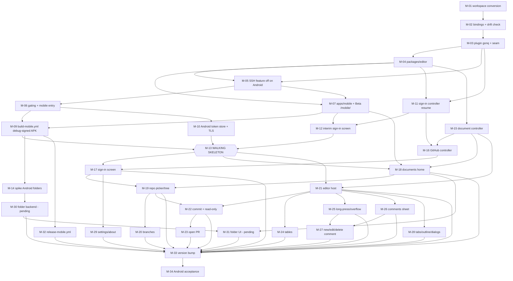

# Gonq Mobile (Android first): implementation stories, 2026-10-29

Intended location: `docs/gonq-mobile-stories-2026-10-29.md`.
Status: plan only. Nothing here has been built or run.
Source read: `crashtest00/gonq` at `dev` (v0.1.5), the corrected mobile mockup `docs/mobile/gonq-mobile-mockup.html`, and `docs/aigang-multi-repo-gaps-2026-10-27.md`.
**Precedence rule.** The actual desktop implementation wins over any spec or mockup. Where the mockup and the desktop source disagree, the story follows the desktop and the mockup is wrong. A mobile adaptation (layout, sheets, stacked buttons) is allowed only when the roles, labels, strings and rules stay the same.

## 1. Purpose and summary

**Purpose.** Break the Gonq mobile app into stories that the owner dispatches one at a time through AI Gang. Each story is implementation-ready on its own.

**Scope of this plan.**

- **The first Beta is an Android APK only.** It is debug-signed (the standard debug signing Tauri/Gradle applies; no release keystore, no secrets) and published from GitHub Actions. Release signing is deferred (section 8).
- **iOS, TestFlight and Play Store are out of this plan.** See section 8, "Deferred: iOS and stores".
- **SSH remote folders are not part of the mobile app.** The `ssh/` module is compiled out of the Android build. Desktop keeps it.

**The plan in five phases.**

1. **Make the code shareable (M-01 to M-07).**
   - One repo becomes Cargo and npm workspaces (`crates/gonq-core`, `packages/editor`, `apps/desktop`, `apps/mobile`).
   - Generated TypeScript bindings make the FE/BE contract a build artifact.
   - Core becomes the Tauri plugin `gonq`.
   - SSH becomes a Cargo feature that the Android build leaves out.
   - Desktop behaviour does not change.
2. **Android walking skeleton (M-09 to M-13).** A debug-signed APK launches on an Android emulator and proves GitHub sign-in end to end: device flow, HTTPS, and the token persisting across an app kill.
   - This covers the two riskiest Android unknowns (the HTTPS verifier and the Android Keystore token store) as early as the dependencies allow.
   - **No mobile UI story starts until M-13 passes.**
3. **The third unknown, Android folder picking (M-14).** A spike runs right after the APK workflow exists, in parallel with the skeleton.
4. **Shared controllers and mobile UI (M-15 to M-31).** Desktop parity for the GitHub review flow, local folders, the editor, comments, tabs, outline and settings. UI stories are built from the corrected mockup, and the frames it still lacks (input I-1) block the stories named there. The local-folder stories are marked **pending spike outcome**.
5. **Release (M-32 to M-34).** `release-mobile.yml` attaches the debug-signed APK to the `v*` GitHub Release as a labelled beta asset, then a version bump, then a human acceptance pass on Android.

### What is shared and what is mobile-only

| Layer | Shared (one copy) | Desktop-only | Mobile-only |
|---|---|---|---|
| Rust | `crates/gonq-core` (Tauri plugin `gonq`): `github/`, `settings.rs`, `recents.rs`, `folder.rs`, document-folder scope commands | `ssh/` behind the Cargo feature `ssh` (on for desktop only); `apps/desktop/src-tauri`: `launch.rs`, single-instance plugin, `focus_main`, `deliver_paths`, file associations | `apps/mobile/src-tauri`: mobile entry point, Android project, Android init (TLS verifier, keystore context) |
| TS contract | Generated bindings for every `gonq` command, generated with `ssh` on | — | — |
| TS logic | `packages/editor`: `editor/`, `comment-threads/`, `platform/`, `document/`, `commands/`, `features/`, `lib/theme`, `styles/tokens.css`, shared controllers | SSH flow state in desktop `App.tsx` and `ConnectDialog.tsx` | — |
| UI | Theme tokens; the command registry is the single source of actions | `MenuBar.tsx`, sidebars, dialogs, `ConnectDialog.tsx`, `ResizablePane.tsx` | Screens, sheets, keyboard accessory, long-press and overflow menus |
| Web build | Desktop web build at Beta `/` | — | Mobile web build at Beta `/mobile/` |

The CLAUDE.md rule "never hide or disable UI by platform; a platform function throws a clear error" applies inside each app: desktop versus desktop-web, and mobile versus mobile-web.

There is one deliberate exception. SSH is not a mobile feature (decision 2), so its commands are **left out** of the mobile menus by an explicit, tested list. They are not hidden per platform. M-05 lists exactly what degrades and what is left out.

## 2. Decisions made, inputs and assumptions

### Decisions made (owner, final)

1. **Mobile CI workflows.**
   - Separate `build-mobile.yml` (workflow_dispatch, `sha` input, builds the debug-signed Android APK) and `release-mobile.yml` (`v*` tag).
   - `build-desktop.yml` and `release-desktop.yml` are not touched by mobile.
   - Jenkins never dispatches the mobile workflows. A human dispatches them, or the orchestrator on the owner's say-so.
   - **Signing (owner, 2026-10-29): the first beta APK is debug-signed**, with the standard debug signing Tauri/Gradle applies automatically. No release keystore, no Actions secrets. Each CI build gets a new debug key, so testers uninstall before installing a newer build (accepted for this beta). Android does not install a truly unsigned APK. Release signing (M-08) is deferred (section 8). M-09, M-32.
2. **No SSH on mobile.** `ssh/` is compiled out of the Android build by a Cargo feature; desktop keeps it. M-05.
3. **The workspace conversion is split.**
   - M-01: the pure conversion.
   - M-02: the generated bindings and the CI drift check.
   - Nothing imports the bindings until M-03.
4. **One manual `build-desktop.yml` dispatch is authorized.** It covers a single run on the M-01 merge SHA, to prove the desktop release build after the conversion.
   - This is not a standing exception.
   - The CLAUDE.md rule that these workflows are "dispatched by Jenkins only … never … run/tag by hand" otherwise stands. M-01 criterion 9.
5. **The first Beta is the Android APK only.** No iOS, TestFlight or Play in this plan (section 8).
6. **The Android walking skeleton comes first.** M-13 gates every UI story.
7. **Confirmed assumptions.**
   - A-1: `commands/` and `features/` move to `packages/editor`, so one registry drives the desktop menu bar and the mobile overflow menu, long-press menu and accessory toolbar.
   - A-8: Beta serves the mobile web build at `/mobile/`, so QE can verify mobile UI on Beta.
8. **Mobile UI decisions D1 to D8 (owner, final).** Desktop behaviour wins; SSH stays out of mobile v1; Android only, no iOS.
   - **D1 Commit:** match desktop. The warning and "Commit to new branch…" appear on any branch not starting with `gonq/`; Commit is primary, Commit to new branch… secondary, plus Cancel; the message is fixed `Edit <path> from Gonq`, no editable message, no Author line. M-22.
   - **D2 Open PR "Branch to merge":** keep the in-memory session list (branches committed this session plus branches of open GitHub tabs, "#N" link where a PR is open). It is empty after Android kills the app, and the UI shows that empty state. Back from the details screen discards edits. Real structure: Repository, Branch to merge, Merge into, Review on one screen; then title and description; then the result with "Open in browser". M-23.
   - **D3 Theme:** only in the ⋯ menu (View > Theme). No theme row in Settings, which holds only author name and GitHub, as desktop's `SettingsDialog`. M-25, M-29.
   - **D4 Table toolbar:** the table bar replaces the formatting bar in table mode. The formatting bar shows a "Table" button only while the caret is in a table, and the table bar has a button back. M-24.
   - **D5 Outline, Comments and Folder navigator:** mobile-only top-bar buttons, not registry commands; no shared registry commands are added. M-25, M-26, M-28, M-31.
   - **D6 Branding:** the real logo asset `gonq-logo-OUTLINE.svg`, no tagline, no invented mark. M-07, M-29.
   - **D7 Sign-in:** keep desktop's idle "Start" screen and show all states (idle, starting, waiting, approved, session-only notice, denied, expired, failed). M-17.
   - **D8 Conflict dialog:** the real Cancel/Overwrite dialog, GitHub only; the "File changed on disk" dialog is deleted from the design. M-22, M-28.
   - **D9 Sign-in killed mid-flow:** if Android kills the app during sign-in, it relaunches at the idle "Start" screen with no extra wording. The device code lives only in memory, as on desktop, and there is no "interrupted" state. M-11, M-12, M-17.
   - **D10 Find in document:** excluded. Desktop has no menu command for it (Ctrl+F is CodeMirror's own search), so mobile adds no touch entry. M-25.

### Inputs still needed from the owner

| # | Input | Blocks |
|---|---|---|
| I-1 | **Mockup frames still missing** after the corrected mockup. The mockup exists at `docs/mobile/gonq-mobile-mockup.html`, and **the desktop implementation wins over it**. The table below the inputs lists what it still lacks, per story | The stories named in that table |
| I-3 | **The owner's approval of one GitHub device code** during the emulator sign-in runs (M-13, M-34). A physical Android phone (Android 10 or later) is optional: the owner's own final look, not a gate | M-13, M-34 |
| I-4 | **Android `applicationId` and app name.** Desktop uses `com.gonq.app` (`src-tauri/tauri.conf.json`). Changing either after testers install forces an uninstall | M-07 (value), M-09 (first APK) |
| I-5 | **The version number for the first mobile RC**, greater than the app version on `dev` when M-33 is dispatched (0.1.5 at the time of this revision) | M-33 |

**I-1 detail: frames still missing, and the stories each blocks.** A story is dispatched only when its frames exist; until then its criteria (which already carry the desktop strings and states) are the specification for the frame. The corrected mockup removes the SSH section, so its later sections are numbered one lower than in the original mockup.

| Missing frames | Blocks |
|---|---|
| Comment thread list, new-comment draft, resolve/reopen, edit, delete confirmation, the empty state "No comments yet.", the read-only state | M-26, M-27 |
| Open PR details screen separate from review, the result screen, already-open, no sources, no changes, truncation, errors | M-23 |
| The full ⋯ tree: submenus, checkbox and radio rows, disabled rows, a long-scroll layout | M-25 |
| Sign-in idle, starting, denied, failed, approved, and copy feedback | M-17, M-12 |
| Recents loading, error, remove-a-recent, and the Open Folder entry | M-18 |
| Tree error and empty-repo states, branch-list caps and errors, the branch-gone fallback, refresh busy and error | M-19, M-20 |
| The commit-conflict dialog in its real wording, and the read-only disabled states | M-22 |
| Settings validation with Save/Cancel, and the "Not signed in." row | M-29 |
| Local folder empty, error and "No folder open" states | M-31 |
| The global error/notice banner pattern | M-17 to M-23 and every story that reports a failure |

### Assumptions still open (correct any that are wrong)

- **A-2.** The plugin name is `gonq`: commands are invoked as `plugin:gonq|<command>`, and the permission set is `gonq:default`.
- **A-3.** Desktop keeps `keyring` 4.2.0 (`KeyringStore`) unchanged. Only `target_os = "android"` gets a new store.
- **A-5.** Android `minSdk` is the Tauri 2 default (24), unless I-4 says otherwise.
- **A-6.** `localStorage` keys (for example `gonq.recentDocuments` on web) survive only if the Android webview origin never changes. M-07 pins the scheme before the first APK.

## 3. Ordered story table

Types: FE = frontend, BE = backend (Rust), DevOps, Spike, Orchestrator = done by the orchestrator (emulator verification), with the human touchpoints the story names.
**Mockup** means the story is built from the corrected mockup, and is blocked only by the frames input I-1 lists as still missing for it.
**Gate** means the story is blocked by M-13, the walking skeleton.
**Pending spike** means the acceptance criteria are provisional until M-14 closes.

| ID | Title | Type | Size | Blocked by |
|---|---|---|---|---|
| M-01 | Workspace conversion (behaviour-neutral) | DevOps/BE/FE | L | — |
| M-02 | Generated command bindings and CI drift check | BE/DevOps | M | M-01 |
| M-03 | `gonq-core` as Tauri plugin `gonq`; platform seam calls the bindings | BE/FE | M | M-02 |
| M-04 | Extract `packages/editor` | FE | L | M-03 |
| M-05 | SSH as a Cargo feature, compiled out of Android; shared TS degrades | BE/FE | M | M-03, M-04 |
| M-06 | Desktop-only gating, mobile entry point, Android `cargo check` in Actions | BE/DevOps | M | M-05 |
| M-07 | `apps/mobile` scaffold and mobile web build on Beta `/mobile/` | FE/DevOps | M | M-04, M-05 |
| M-09 | `build-mobile.yml`: debug-signed Android APK | DevOps | M | M-06, M-07 |
| M-10 | Android token store (keyring-core), Android TLS verifier init | BE | M | M-06 |
| M-11 | Shared sign-in controller: re-poll on resume, wall-clock expiry | BE/FE | M | M-03, M-04 |
| M-12 | Interim sign-in screen for the walking skeleton | FE | S | M-07, M-11 |
| M-13 | **Milestone: Android walking skeleton on an emulator** | Orchestrator | S | M-09, M-10, M-12 |
| M-14 | Spike: Android local folders (SAF `content://`, dialog folder pick) | Spike | M | M-09 |
| M-15 | Shared document controller out of `App.tsx` | FE | M | M-04 |
| M-16 | Shared GitHub controller out of `App.tsx` | FE | M | M-11, M-15 |
| M-17 | Mobile GitHub sign-in screen | FE | M | M-13, M-16, Mockup |
| M-18 | Documents home: recents and entry points | FE | M | M-07, M-13, M-15, Mockup |
| M-19 | Mobile repo picker and repo tree with refresh | FE | M | M-17, M-18, Mockup |
| M-20 | Mobile branch switcher, create branch, change-branch warning | FE | M | M-19, Mockup |
| M-21 | Mobile editor host, keyboard accessory toolbar, raw switch | FE | M | M-13, M-15, Mockup |
| M-22 | Mobile commit sheet, commit conflict, read-only PR banner | FE | M | M-19, M-21, Mockup |
| M-23 | Mobile Open PR flow (four screens) | FE | M | M-22, Mockup |
| M-24 | Touch table editing | FE | M | M-21, Mockup |
| M-25 | Long-press context menu and overflow (⋯) menu from the registry | FE | M | M-21, Mockup |
| M-26 | Comments bottom sheet: read, reply, resolve, reopen | FE | M | M-21, Mockup |
| M-27 | New comment, edit and delete by touch | FE | M | M-25, M-26 |
| M-28 | Tabs, outline, unsaved-changes and conflict dialogs | FE | M | M-21, Mockup |
| M-29 | Settings, About, Agent skill | FE | M | M-17, Mockup |
| M-30 | Android local folder backend (**pending spike**) | BE | L | M-14 |
| M-31 | Android local folder navigator, open and save (**pending spike**) | FE | M | M-18, M-30 |
| M-32 | `release-mobile.yml`: attach the debug-signed APK to the `v*` GitHub Release | DevOps | M | M-09 |
| M-33 | Version bump for the first mobile release candidate | DevOps | S | M-17 to M-32 |
| M-34 | Android acceptance pass on the release candidate | Orchestrator | M | M-33 |

**Dispatch order.** Stories are dispatched in ID order. M-08 (release keystore) is deferred (section 8) and is not part of this plan's dispatch.
**Exercising the risks early.** The HTTPS verifier and the Android Keystore token store are first exercised at M-13. That is the earliest possible point: they need an APK (M-09) and a sign-in path (M-12). Folder picking is exercised at M-14, which needs only M-09.

### Dependency graph

M-33 is blocked by every feature story (M-17 to M-32); the graph shows each of those edges.

---

## 4. Epics and stories

### Epic A: Workspace foundation and shared contract

#### M-01 Workspace conversion (behaviour-neutral)

**Goal.** Turn the repo into Cargo and npm workspaces with no behaviour change. Prove that the Jenkins PR build, the Beta web deploy and the desktop release build still work.

**Why.** AI Gang runs one repository per project (gaps 2, 4 and 5 in `docs/aigang-multi-repo-gaps-2026-10-27.md`), so code sharing has to happen inside this repo. Every later story depends on these paths existing.

**Target layout.**

- **Root `Cargo.toml`**, `members = ["crates/gonq-core", "apps/desktop/src-tauri"]`. `Cargo.lock` and `target/` move to the root.
- **`crates/gonq-core/`** gets:
  - `src-tauri/src/{github/,ssh/,folder.rs,recents.rs,settings.rs}`;
  - the non-launch commands now in `src-tauri/src/lib.rs`: `allow_document_folder`, `list_directory`, `path_exists`, `recent_documents_*`, `allow_recent_document`, `get/set_author_name`, `get/set_theme`, `get_pane_widths`, `set_pane_width`.

  It is still a plain library: the desktop app registers these commands by path in `generate_handler!`.
- **`apps/desktop/src-tauri/`** gets `main.rs`, `lib.rs` (`run`, single-instance, `focus_main`, `deliver_paths`, `take_launch_paths`), `launch.rs`, `pane_width_ipc_tests.rs`, `tauri.conf.json`, `capabilities/`, `icons/` and `build.rs`.
- **`apps/desktop/`** gets `src/`, `index.html`, `vite.config.ts`, `tsconfig.json`, `tailwind.config.js`, `postcss.config.js`, `components.json`, `e2e/` and `playwright.config.ts`.
- **`packages/editor/`** is an empty workspace with its own `package.json`. M-04 fills it.
- **Root `package.json`** gets `"workspaces": ["apps/*", "packages/*"]`. The root `test` and `build` scripts fan out, so the Jenkins `npm ci`, `npm test` and `npm run build` commands do not change.

**Acceptance criteria.**

1. Moves are plain `git mv` in a commit with no content edits, and path fixes are a separate commit, so `git log --follow` works.
2. Root `npm ci && npm test && npm run build` passes. The vitest test count equals the count on `dev` before the change; the PR states both numbers.
3. `npm test` still runs `map:check`. `scripts/project-map.mjs` `SOURCE_DIRS` (now `['src', 'src-tauri/src']`) lists every new source root, and every moved file keeps its header comment.
4. From the root, `cargo test --locked --workspace` and `cargo clippy --locked --workspace --all-targets -- -D warnings` pass. The Rust test count is unchanged (state both numbers).
5. `rust-checks.yml` uses the root workspace: `rust-cache` `workspaces: ". -> target"`, cargo run from the root, and the `npm run build` it needs for `generate_context!` still runs first.
6. The `Jenkinsfile` `Rust checks` stage path filter (`grep -q '^src-tauri/'`) becomes `^(crates/|apps/[^/]+/src-tauri/|Cargo\.toml$|Cargo\.lock$)`.
   - The PR links one Rust-touching PR build that ran the checks, and one frontend-only PR build that logged `SKIP`.
   - Only this project-specific stage changes. The shared template stages are untouched (CLAUDE.md: "don't hand-edit its shared stages").
7. `Dockerfile` copies the root `package.json`, `package-lock.json` and each workspace `package.json` before `npm ci`, and copies `apps/desktop/dist` into nginx. After merge, QE loads Beta, opens a document, toggles Raw, and checks About shows `0.1.5`.
8. `build-desktop.yml` and `release-desktop.yml` use the new paths: `rust-cache` `workspaces: ". -> target"`, `cargo test --locked --workspace` from the root, and `artifact_glob` `target/release/bundle/...`. Nothing else in them changes.
9. **Desktop release proof (human, authorized once).** One manual `workflow_dispatch` of `build-desktop.yml` with `sha` = the M-01 merge SHA produces the Windows, macOS and Linux artifacts. The PR or work item records the run link.
   - The authorization covers that one run on that one SHA only.
   - A re-run (for example after a fix) needs a new owner go-ahead.
10. CLAUDE.md "Key Directories" and "Entry Points" describe the new layout, and the `docs/` links still resolve.
11. `npm run tauri dev` and `npm run tauri build` run from `apps/desktop`. `tauri.conf.json` `frontendDist` resolves to `apps/desktop/dist`.

**FE/BE contract.** No command changes name or shape.

**Out of scope.** Bindings (M-02). The plugin (M-03). Moving TS into `packages/editor` (M-04). Any mobile file.

**Risks and unknowns.**

- **Jenkins box load.** Workspaces make `npm test` heavier on a box that has failed vitest under cargo load before (dev build 103). Cargo never runs on Jenkins, because the checks are dispatched to Actions, and this must stay true.
- **Conflicts with open PRs.** The PR touches every path, so any open PR on `dev` conflicts. Dispatch it with nothing else in flight.

**Verification.**

- Beta (QE): criterion 7, plus a smoke of open, edit, save-as-download, comments and theme.
- Jenkins: criteria 2 and 6.
- Human: criterion 9, plus a desktop launch from one artifact showing the same version and behaviour.

#### M-02 Generated command bindings and CI drift check

**Goal.** Generate TypeScript bindings for every Rust command, and fail CI when the committed bindings drift from the Rust. Nothing imports them yet; M-03 adopts them.

**Why.** It makes the FE/BE contract a build artifact. Several FE/BE mismatches in past Gonq stories were the kind a generated contract catches at `tsc`.

**Acceptance criteria.**

1. A Rust test (for example `crates/gonq-core/tests/export_bindings.rs`) writes `apps/desktop/src/platform/bindings.ts` through tauri-specta. M-04 moves the file.
   - It covers all 38 commands in the current `generate_handler!` list in `src-tauri/src/lib.rs`, with the `ssh` code present (M-05 makes `ssh` a feature; bindings are always generated with it on).
   - The file starts with a generated-file header that `map:check` accepts.
2. `rust-checks.yml` runs the export and then `git diff --exit-code` on the file. The PR links one run with deliberate drift that failed, and one clean run.
3. Error types serialise to the shapes the TS side already parses: `GithubError` (via `toGitHubError`, `src/platform/github.ts:104`), and `RemoteError` and `ListError` as `{kind, message}` (via `toRemoteError`, `src/platform/remote.ts:128`). A Rust test checks one sample of each.
4. These types that tauri-specta cannot derive are overridden explicitly, not skipped:
   - `remote_read` returns `tauri::ipc::Response` (raw bytes, `ssh/mod.rs:74`);
   - `Answers` (`ssh/auth.rs:85`) holds zeroizing secrets.
5. No runtime code changes, and the desktop app behaves identically.

**FE/BE contract.** `bindings.ts` is the contract from here on: the command names and the argument and result types.

**Out of scope.** Calling the bindings (M-03).

**Risks and unknowns.**

- **tauri-specta maturity.** tauri-specta for Tauri 2 has been a release candidate for a long time. A version that works with `tauri 2.12.1` (from `Cargo.lock`) is UNVERIFIED.
- **Fallback.** Use `specta` plus a hand-maintained command list exported by the same test. The drift check still guards it. Record which path was taken in the PR.

**Verification.** CI (rust-checks on Actions), criterion 2. QE: Beta is unchanged (smoke only).

#### M-03 `gonq-core` as Tauri plugin `gonq`; platform seam calls the bindings

**Goal.** Package `crates/gonq-core` as a Tauri plugin that registers its own commands and managed state, and switch `src/platform/*` from string `invoke` calls to the bindings.

**Why.** The desktop and mobile shells need the same commands, state and permissions without copying the `generate_handler!` list. The managed state is `ssh::new_pool()`, `github::Github::production()` and `ssh::fs::Remote`.

**Acceptance criteria.**

1. `gonq_core::init()` returns a `TauriPlugin`. Its setup does the three `.manage(...)` calls now in `src-tauri/src/lib.rs:run`, and it registers all 37 core commands.
2. `apps/desktop/src-tauri/src/lib.rs` registers `.plugin(gonq_core::init())` and keeps only `take_launch_paths` in its own `generate_handler!`.
3. The plugin's `build.rs` generates the permissions, and `capabilities/default.json` grants `gonq:default`. A Rust test asserts that every core command is allowed.
4. Every core `invoke(...)` in `src/platform/{files,folders,recents,settings,remote,connect,github}.ts` calls the generated binding. `grep -rn "invoke(" apps/desktop/src/platform` finds only `take_launch_paths` (`openPaths.ts`) and the bindings file.
5. `src/platform/*.test.ts` mock at the bindings layer and pass. Component tests change only their mocks.
6. The desktop web build keeps its error texts (`GITHUB_UNAVAILABLE`, `CONNECT_UNAVAILABLE` and the others).

**FE/BE contract.** Command names become `plugin:gonq|<name>`. Argument and result shapes are unchanged, and the bindings are the reference.

**Out of scope.** Moving TS (M-04). The SSH feature (M-05).

**Risks and unknowns.**

- Plugin commands need capability permissions, and a missing one fails at runtime, not at compile time. That is why criterion 3 is a test.
- `allow_document_folder` uses `tauri_plugin_fs::FsExt` from inside a plugin. Expected to work through `AppHandle`; UNVERIFIED.

**Verification.**

- Beta (QE): the web error texts are unchanged.
- Human, on desktop (`tauri dev` or an artifact): GitHub sign-in, open repo, SSH connect and a local folder still work.

#### M-04 Extract `packages/editor`

**Goal.** Move the shareable frontend into `packages/editor`. `apps/desktop/src` stays as the desktop shell.

**What moves:**

- `editor/`, `comment-threads/`, `platform/` (with `bindings.ts`), `document/`;
- `commands/` and `features/` (A-1, confirmed);
- `dialogs/DialogHost.tsx`, `lib/theme.ts`, `lib/useTheme.ts`;
- `styles/tokens.css`, `styles/editor.css`;
- `agent-skill/`, `testing/editor.ts`.

**Why.** Mobile must reuse the CodeMirror editor, the comment-threads library, the platform seam and the command registry exactly.

**Acceptance criteria.**

1. `packages/editor/package.json` (`"name": "@gonq/editor"`) has an `exports` map, and `apps/desktop` imports `@gonq/editor/...`. A lint rule or test forbids relative imports that cross a package boundary.
2. Editor files no longer import from `components/`. The present couplings are `src/editor/MarkdownEditor.tsx` importing `../components/formatting` and `../components/toc`. The pure modules (`formatting.ts`, `toc.ts`, `outline.ts`, `threads.ts`, `newThread.ts`) move into the package.
3. `features/*/index.ts` auto-loading via `commands/index.ts` still works, and `src/features/menus.test.tsx` passes unchanged.
4. The test count is unchanged. Tests move with their files, and `src/testing/renderApp.tsx` stays in the desktop app.
5. `map:check` covers `packages/editor/src`.
6. The CLAUDE.md conventions are updated:
   - native calls live in `packages/editor/src/platform/`;
   - menus come from `packages/editor/src/features/`;
   - "Never edit MenuBar.tsx" names the desktop file.
7. Tailwind `content` globs include `packages/editor/src`. vitest's `css: { include: [/editor\.css/] }` still applies to the moved CSS.

**FE/BE contract.** None.

**Out of scope.** Logic changes, and splitting `App.tsx` (M-15, M-16).

**Risks and unknowns.** Purged CSS classes from a wrong Tailwind glob would only show visually; QE's Beta smoke is the guard.

**Verification.** Beta (QE) smoke, as in M-01 criterion 7. Jenkins tests.

#### M-05 SSH as a Cargo feature, compiled out of Android; shared TS degrades

**Goal.** Put `crates/gonq-core/src/ssh/` and its dependencies behind a Cargo feature `ssh`. Desktop enables it and the mobile app does not, so the APK carries no SSH code. The shared TS code fails clearly, rather than calling missing commands.

**Why.** Owner decision 2: no SSH on mobile.

**Acceptance criteria.**

1. **Dependencies.** `russh`, `russh-sftp` and `ssh2-config` become `optional = true` dependencies of `gonq-core`, enabled by feature `ssh`. `apps/desktop/src-tauri` depends on `gonq-core` with `features = ["ssh"]`.
2. **Gated Rust code.** All of these are under `#[cfg(feature = "ssh")]`:
   - `mod ssh`;
   - the 9 commands (`ssh_list_hosts`, `ssh_connect`, `ssh_disconnect`, `remote_list_folders`, `remote_open_root`, `remote_list_directory`, `remote_read`, `remote_write`, `remote_exists`);
   - the `ssh::new_pool()` and `ssh::fs::Remote` state;
   - the `ssh::is_ssh_path` branch in `allow_recent_document`.

   Without the feature, `allow_recent_document` refuses an `ssh://` path with "SSH is not available in this build."
3. **A test proves which build has which commands.**
   - `gonq_core::COMMANDS`, the list that also feeds the plugin's permission build, is asserted in a Rust test: with `--features ssh` it contains all 9 SSH commands, and with `--no-default-features` it contains none of them.
   - `rust-checks.yml` runs `cargo test -p gonq-core --no-default-features` in addition to the workspace tests.
4. **The Android build has no SSH crates.** Once M-06 adds the Android target, `cargo tree -p gonq-mobile --target aarch64-linux-android -e normal` lists no `russh`, `russh-sftp` or `ssh2-config`, and CI fails if it does. Until M-06 lands, the same check runs on `gonq-core --no-default-features`.
5. **The bindings stay one file**, generated with `ssh` on (M-02). The mobile app must therefore never reach an SSH command; criteria 6 and 7 enforce this.
6. **Shared TS degrades.** `packages/editor/src/platform/app.ts` exports `appKind(): 'desktop' | 'mobile'`, read from a Vite define `__GONQ_APP__` (default `'desktop'`; M-07 sets `'mobile'`). When `appKind() === 'mobile'`:
   - `platform/connect.ts`: `assertConnectAvailable()` throws `CONNECT_UNAVAILABLE_MOBILE` ("Connecting to a server is not part of the Gonq mobile app."). The pure helpers (`parseConnectInput`, `remoteUri`, `sshPathOf`) are unchanged.
   - `platform/remote.ts`: `remoteRead`, `remoteWrite`, `remoteExists` and `withConnect` throw `RemoteFileError` of kind `unavailable` with the same text. The parsing helpers (`isSshPath`, `parseSshPath`, `remoteHost`) are unchanged.
   - `platform/files.ts`, `folders.ts` and `images.ts`: `ssh://` routing reaches those errors, so opening, listing or loading an image from an `ssh://` path fails with the banner, never a crash.
   - `platform/recents.ts`: an `ssh://` recent cannot originate on mobile (recents are per-device). If one is ever present, opening it shows the error above.
   - Vitest covers each item with `__GONQ_APP__ = 'mobile'`.
7. **Left out of the mobile UI** (decision 2, not platform hiding):
   - `ConnectDialog.tsx` and the desktop SSH flow state in `App.tsx` stay desktop-only and are not moved into shared controllers.
   - The `ssh://` root handling in `FolderSidebar.tsx` stays desktop-only. The mobile folder navigator (M-31) handles local and `github://` roots only.
   - The registry commands File > Connect to Server… (`openConnect`) and the remote-folder recents are listed in `apps/mobile/src/excludedCommands.ts`. The mobile overflow and long-press menus (M-25) skip them, and a test asserts the exact list.
8. Desktop is unchanged: all SSH tests pass, and the desktop web build still shows `CONNECT_UNAVAILABLE`.

**FE/BE contract.** No new commands. `COMMANDS` (the Rust constant) is exported from `gonq-core` for the test. New TS export: `appKind()`.

**Out of scope.** Removing SSH from desktop. Any mobile screen.

**Risks and unknowns.**

- **Missed cfg sites.** Code in `lib.rs` that references `ssh::` beyond the known sites fails to compile without the feature. That failure is the guard, so it is safe.
- **Bindings include SSH commands.** The mobile app could still import them; criteria 6 and 7 are the only guard.

**Verification.** CI: criteria 3 and 4. Jenkins: vitest, criterion 6. Beta (QE): the desktop SSH web error is unchanged.

#### M-06 Desktop-only gating, mobile entry point, Android `cargo check` in Actions

**Goal.** Make the Rust compile for `aarch64-linux-android` with a mobile app crate in `apps/mobile/src-tauri`, and prove it in GitHub Actions.

**Why.** `tauri-plugin-single-instance` is registered unconditionally in `src-tauri/src/lib.rs:run` and is desktop-only. `launch.rs` (argv paths) and `focus_main` (`unminimize`/`set_focus`) are desktop concepts too.

**Acceptance criteria.**

1. `tauri-plugin-single-instance` moves under `[target.'cfg(not(any(target_os = "android", target_os = "ios")))'.dependencies]` in `apps/desktop/src-tauri/Cargo.toml`, and its `.plugin(...)` call is under `#[cfg(desktop)]`.
2. `apps/mobile/src-tauri` (crate `gonq-mobile`) contains:
   - `lib.rs` with `#[cfg_attr(mobile, tauri::mobile_entry_point)] pub fn run()`, registering `gonq_core::init()` (no `ssh` feature) and the dialog, fs and opener plugins;
   - `tauri.conf.json`;
   - `capabilities/mobile.json`, which grants `gonq:default` and the opener allow-list `https://github.com/crashtest00/gonq` and `https://github.com/login/device`.
3. `rust-checks.yml` adds an Android job on an ubuntu runner: install the NDK, then `cargo check -p gonq-mobile --target aarch64-linux-android` and the M-05 `cargo tree` check.
4. Desktop is unchanged: the `launch.rs` tests pass, and a human checks the second-instance hand-off on one desktop OS.

**FE/BE contract.** No new commands.

**Out of scope.** `tauri android init` and the APK (M-09).

**Risks and unknowns.**

- `ring`, `rustls` and `reqwest` on Android are expected to compile; UNVERIFIED in this repo.
- Android NDK setup on the runner adds minutes to every Rust-touching PR. Record the time.

**Verification.** Actions CI. Human desktop check.

#### M-07 `apps/mobile` scaffold and mobile web build on Beta `/mobile/`

**Goal.** A React 18 + Vite 5 app in `apps/mobile` that imports `@gonq/editor`. It renders a phone shell with theme tokens only: a safe-area top bar, a stack navigator, and a bottom-sheet primitive. Beta serves it at `/mobile/`.

**Why.** Every mobile UI story needs the shell, and QE verifies on Beta (A-8, confirmed).

**Acceptance criteria.**

1. `apps/mobile/vite.config.ts` uses `base: '/mobile/'` for the web build and the Tauri `devUrl`/`frontendDist` for native, and defines `__GONQ_APP__ = 'mobile'`.
2. `apps/mobile/src/main.tsx` applies the saved theme before first paint, as `src/main.tsx` does.
3. `Dockerfile` builds both apps. `nginx.conf` adds `location /mobile/ { try_files $uri /mobile/index.html; }`, and `/` is unchanged.
4. Placeholder screens: Splash and an empty Documents home. They use the real logo asset `gonq-logo-OUTLINE.svg` from `assets/`, unmodified and uncoloured ("the logo is never recoloured"). There is no tagline, no wordmark with a rule and no invented mark (decision D6).
5. The viewport is `width=device-width, initial-scale=1, viewport-fit=cover, interactive-widget=resizes-content`, with safe-area insets from `env(safe-area-inset-*)`.
6. `apps/mobile/src/testing/renderMobileApp.tsx`, modelled on `renderApp.tsx`, plus an opt-in `e2e/mobile-shell.spec.ts` using a Playwright Pixel device profile.
7. The mobile `tauri.conf.json` uses the I-4 identifier, and the Android webview scheme (`useHttpsScheme`) is set explicitly and never changed (A-6).
8. `map:check` covers `apps/mobile/src`. CLAUDE.md gains an `apps/mobile` entry that states:
   - the platform rule applies inside each app;
   - mobile-web errors and never hides;
   - SSH is left out of mobile by the M-05 list.

**FE/BE contract.** None.

**Out of scope.** Feature screens. The Android project (M-09).

**Risks and unknowns.** The Beta image build time roughly doubles, and Jenkins `npm run build` now builds both apps, adding load on the box.

**Verification.** Beta (QE): `/mobile/` in a phone viewport in light and dark; `/` is unchanged.

### Epic B: Android walking skeleton (milestone gate)

#### M-09 `build-mobile.yml`: debug-signed Android APK

**Goal.** A `workflow_dispatch` workflow builds a debug-signed `aarch64` APK of `apps/mobile` for a given SHA and uploads it as an artifact.

**Why.** The walking skeleton (M-13) and the spike (M-14) need an installable APK. The Jenkins box must never build Android, because it needs the SDK and NDK and the box has failed builds under load.

**Acceptance criteria.**

1. `apps/mobile/src-tauri/gen/android` is generated by `tauri android init` and committed. Build outputs are ignored.
2. The workflow pins JDK 17, the Android SDK and the NDK versions, and caches Gradle and Cargo.
3. Input: `sha` (required), checked by the same "Verify checkout matches requested SHA" step as `build-desktop.yml`.
4. **Debug signing (owner decision, 2026-10-29).** The APK is signed with the standard debug signing that Tauri/Gradle applies automatically. The workflow uses no keystore, no Actions secrets and no fingerprint pin. `apksigner verify` on the output passes (it is signed, not unsigned: Android installs no unsigned APK).
5. The artifact is named `gonq-android-debug-signed-<sha>.apk`. The workflow's job summary and the PR say that each CI build gets a new debug key, so a tester must uninstall an earlier build before installing a newer one (accepted for this beta).
6. The only trigger is `workflow_dispatch`. The header comment says: "Dispatched by a human, or by the orchestrator on the owner's say-so. Jenkins never dispatches it. Never add pull_request/push/tag triggers."
7. The PR records the run time. Background waits on this workflow are bounded at about three times that.

**FE/BE contract.** None.

**Out of scope.** Release signing (M-08, deferred, section 8). Attaching to a GitHub Release (M-32). Play (section 8).

**Risks and unknowns.**

- Gradle and NDK version drift against Tauri 2.12's Android template; UNVERIFIED until the first run.
- Each build has a new debug key, so installing a newer build over an older one is refused; testers uninstall first (accepted for this beta). `versionCode` is constant until M-33 derives it.

**Verification.** An Actions run link with the artifact, and `apksigner verify` passing on it.

#### M-10 Android token store (keyring-core), Android TLS verifier init

**Goal.** Persist the GitHub token in the Android Keystore through the existing `TokenStore` trait (`src-tauri/src/github/store.rs`), and make HTTPS to github.com work on Android.

**Why.**

- **Token store.** `keyring::Entry::new` (keyring 4.2.0) returns `NoDefaultStore` on Android. `classify` maps that to `StoreError::Unavailable`, so tokens would be session-only (`Storage::SessionOnly`).
- **TLS.** `reqwest` 0.13 with rustls resolves to `rustls-platform-verifier` 0.7.1 (`Cargo.lock`). On Android that crate needs a JNI initialisation call and its Android (Kotlin) component in the Gradle build, or certificate verification fails. This comes from the crate's documented requirements; UNVERIFIED in this app.

**Acceptance criteria.**

1. `store.rs` gains `AndroidStore` on `keyring-core` (already a transitive dependency at 1.0.1) and `android-native-keyring-store` 1.0.0, under `cfg(target_os = "android")`, with the same `SERVICE`/`ACCOUNT` constants.
2. `Github::production()` picks `AndroidStore` on Android and `KeyringStore` elsewhere. Desktop is byte-identical, and `github/tests.rs` passes unchanged.
3. Errors map through the same rule, "Only fixed text: some variants carry the secret's bytes", and a test covers it.
4. If the store still reports unavailable, the app falls back to session-only as today. `github_status` then reports `storage: "session_only"`.
5. `apps/mobile/src-tauri` initialises, at startup:
   - `ndk-context`, which Tauri Mobile is documented to provide (UNVERIFIED);
   - `rustls-platform-verifier`'s Android init, using its current API.

   The Gradle project includes the verifier's Android component.
6. A debug-only command `keychain_selftest` (`cfg(debug_assertions)`, absent from release builds) writes, reads and deletes a dummy entry under account `selftest`. It never touches the real token.
7. The M-06 Android `cargo check` passes.

**FE/BE contract.**

- `keychain_selftest() -> { store: "keychain" | "unavailable"; round_trip: boolean; error: string | null }`. Debug builds only.
- `github_status` is unchanged: `{ signed_in, login, storage: "keychain" | "session_only" | null }`.

**Out of scope.** Biometric gating. iOS (section 8).

**Risks and unknowns.**

- R-1: both inits are unverified.
- Android Keystore entries do not survive an uninstall, so the UI must not promise that they do.

**Verification.** CI (compile, unit tests with a mock store). Device: M-13.

#### M-11 Shared sign-in controller: re-poll on resume, wall-clock expiry

**Goal.** Move the device-flow state machine out of `GitHubSignInPanel.tsx` into `packages/editor/src/controllers/signIn.ts`, and make it survive the phone suspending Gonq while the user approves at `github.com/login/device`.

**Why.**

- `Github::poll` (`src-tauri/src/github/flow.rs`) is one long `async` loop on `tokio::time::sleep_until`, with an `Instant` deadline. Android suspends background apps, so the webview's pending `invoke` may never resolve.
- `Instant` uses `CLOCK_MONOTONIC`, which stops in deep sleep, so the expiry is wrong.
- The design already lets a newer `poll` supersede an older one ("A fresh channel supersedes any poll already running"), so re-polling on resume is safe.

**Acceptance criteria.**

1. `Pending.deadline` uses wall-clock time (`SystemTime`). After resume, an expired code returns `GithubError::Expired` without a network call. A Rust test uses `Config.time_unit` and a fake clock.
2. New command `github_pending` (contract below).
3. The controller re-calls `pollSignIn()` when the app resumes and `github_pending().pending` is true.
   - Resume means `document.visibilitychange`, plus Tauri's mobile resume event if one exists (UNVERIFIED in 2.12).
   - A vitest test covers hide, resume, re-poll and success, and checks there are never two polls in flight.
4. If the process was killed while the user was away (`pending: false` and not signed in), the controller ends in the idle "Start" state (decision D9). There is no "interrupted" state or extra wording, and never a spinner.
5. Copy code uses `platform/clipboard.ts` `copyText`, then Open uses `platform/external.ts` `openExternal`, in that order (test).
6. The desktop `GitHubSignInPanel.tsx` uses the controller, and `GitHubSignIn.test.tsx` passes unchanged.

**FE/BE contract.**

- New: `github_pending() -> { pending: boolean; expires_at_ms: number | null }`.
- Unchanged: `github_start -> DeviceStart { user_code, verification_uri, expires_in, interval }`, `github_poll -> AuthStatus`.

**Out of scope.** Mobile screens (M-12 interim, M-17 final).

**Risks and unknowns.**

- A clipboard write in the Android webview at `http(s)://tauri.localhost` is expected to count as a secure context; UNVERIFIED. `clipboard.ts` already has a fallback.
- The OS may kill sockets while the app is backgrounded. The loop already `continue`s on network errors.

**Verification.** Jenkins (vitest). rust-checks (Rust tests). Beta (QE): desktop web sign-in still errors with `GITHUB_UNAVAILABLE`. Device: M-13.

#### M-12 Interim sign-in screen for the walking skeleton

**Goal.** A minimal, plainly styled screen in `apps/mobile/src/screens/SignInInterim.tsx`, driven by the M-11 controller. It lets the skeleton APK sign in, show the signed-in login and storage kind, and sign out.

**Why.** The skeleton must prove sign-in on the CI-built APK, without relying on a webview console, before the mockups exist. The screen's header comment says M-17 replaces it.

**Acceptance criteria.**

1. Reachable from the placeholder Documents home with a "Sign in to GitHub" row.
2. It shows the user code, Copy code, Open GitHub, waiting, expired and denied states, the signed-in login, and "session only" when `storage` is `session_only`.
3. Theme tokens only, and a header comment.
4. On Beta `/mobile/`, Sign in shows the web error banner (never hidden).
5. Vitest covers each state with mocked bindings.

**FE/BE contract.** Uses `github_start`, `github_poll`, `github_pending`, `github_status` and `github_sign_out`.

**Out of scope.** The final design (M-17).

**Risks and unknowns.** None beyond M-11.

**Verification.** Beta (QE): the layout and the web error. Device: M-13.

#### M-13 Milestone: Android walking skeleton on an emulator

**Goal.** The orchestrator confirms on an Android emulator that the debug-signed APK works end to end. **This gates every mobile UI story.**

**Where it runs.** An Android emulator (Android 10 or later), in GitHub Actions or wherever it is feasible without heavy builds on the Jenkins box. If the emulator cannot run the `aarch64` APK, the work item records why and what was used instead.

**The one human touchpoint.** The owner approves the GitHub device code once, in their own browser. The orchestrator reads the code from the emulator screen and asks for the owner to be notified; it does not poll for the approval in a tight loop. Installing on the owner's real phone is the owner's optional final look, not a gate.

**Acceptance criteria.**

1. The debug-signed APK from M-09 for the current `dev` SHA installs and launches to the Documents placeholder, in light and dark (system setting).
2. Sign in with the device flow: tap Copy code, then Open GitHub; the owner approves the code in their own browser; return to Gonq. The screen shows the login. This proves the device flow, resume (M-11) and HTTPS to `api.github.com` (M-10).
3. The screen shows storage "keychain", not "session only" (M-10 Keystore).
4. After force-stop and relaunch, the app is still signed in with the same login.
5. In airplane mode, a sign-in attempt shows the network error text, and there is no crash.
6. Sign out, then relaunch: the app is signed out.
7. Results go on the work item: emulator image and Android version, APK SHA, and screenshots for criteria 2 to 4.
8. Any failure becomes a rework story on M-10, M-11 or M-12. Mobile UI stories stay blocked until all of 1 to 6 pass.

**FE/BE contract.** None.

**Out of scope.** Anything beyond sign-in.

**Risks and unknowns.** If 2 fails with a certificate error, R-1's TLS half is confirmed and M-10 reopens.

**Verification.** The orchestrator, on the emulator, with the owner's single device-code approval.

#### M-14 Spike: Android local folders (SAF `content://`, dialog folder pick)

**Goal.** Decide how Gonq's local-folder function works on Android, and write the decision to `docs/mobile-local-folders.md`. The function is Open Folder, list Markdown files, open, save, save-as, relative images, and reopen from recents after a restart.

**Why.** The present commands assume `std::fs` paths and the Tauri fs scope: `list_directory`, `path_exists`, `allow_document_folder` and `allow_recent_document` in `src-tauri/src/lib.rs`, `folder::list_directory` in `folder.rs`, and string paths in `recents.rs`. Android pickers return `content://` tree URIs through the Storage Access Framework.

**Timing.** This runs as soon as an APK exists, so the folder-picking unknown is answered before any UI work. The technical questions need no mockups; the UI story (M-31) still does.

**Questions the spike must answer, with device evidence** (from an Android emulator first; a real phone is not required).

1. Can `tauri-plugin-dialog` 2.8.1 pick a **folder** on Android, and what does it return? Folder picking on mobile is UNVERIFIED and may be missing. If it is missing, what is the smallest Tauri mobile plugin (Kotlin, `ACTION_OPEN_DOCUMENT_TREE`) that can?
2. Can `tauri-plugin-fs` 2.6.0 list, read and write under a picked tree URI? Does `takePersistableUriPermission` keep access after a restart?
3. What identifier goes in `recent.json` (an opaque handle versus a path), and how do `github://` recents stay unchanged beside it?
4. Do relative images (`platform/images.ts` `resolveImagePath`) resolve under the chosen model?
5. Can a save be atomic, or at least conflict-checked? Desktop SSH and GitHub saves refuse to overwrite a file that changed.
6. Is an "app documents folder only" fallback viable for the first Beta, if 1 or 2 fail? Present it to the owner with evidence.

**Acceptance criteria.**

1. The doc answers 1 to 6 with a throwaway branch (not merged), a debug APK from M-09, and screenshots and logs.
2. It proposes the final M-30 contract and the M-31 screens, and lists the desktop behaviours that cannot be matched.
3. M-30 and M-31 are rewritten from the outcome before dispatch.

**FE/BE contract.** Proposed in the doc.

**Out of scope.** Production code.

**Risks and unknowns.** R-3.

**Verification.** Review of the doc. Device evidence from an Android emulator.

### Epic C: Shared controllers

#### M-15 Shared document controller out of `App.tsx`

**Goal.** Move document-session logic from `apps/desktop/src/App.tsx` (1005 lines) into `packages/editor/src/controllers/document.ts`. The logic covers:

- new, open, open-from-recents and save;
- save-as;
- the close-tab unsaved guard (`UnsavedChangesDialog` decision);
- GitHub conflict handling (`ConflictDialog` decision);
- `guardClose` wiring from `platform/lifecycle.ts`.

**Why.** "Match the desktop app's function": if mobile re-implements these, the two apps drift. The controller returns state and actions, and each shell renders its own dialogs.

**Acceptance criteria.**

1. `useDocumentController()` exposes the `CommandContext` fields it owns: `save`, `saveAs`, `newFile`, `openFile`, `closeTab`, `hasDocument`, `session`.
2. Dialog choices are injected as async callbacks, for example `confirmUnsaved(name) => Promise<'save'|'discard'|'cancel'>`.
3. `App.tsx` uses the controller. These pass unchanged: `App.test.tsx`, `App.edit.test.tsx` (frozen), `App.openPaths.test.tsx`, `src/features/view/refreshKeepsTabs.test.tsx`.
4. A new `controllers/document.test.ts` covers dirty close in all three branches, a save conflict, and save-as onto a taken name (`PathTakenError`).
5. The SSH conflict path stays wired as today on desktop. The controller treats an `ssh://` tab as a regular remote document, and on mobile the M-05 error surfaces.

**FE/BE contract.** None.

**Out of scope.** GitHub flows (M-16).

**Risks and unknowns.** Hidden coupling to the React render cycle in `App.tsx`; the frozen tests are the guard.

**Verification.** Jenkins. Beta (QE): a smoke of open, edit, close-dirty and save.

#### M-16 Shared GitHub controller out of `App.tsx`

**Goal.** Move the GitHub flows into `packages/editor/src/controllers/github.ts`:

- `ensureSignedIn` / `setSignInHandler` wiring (`platform/github.ts:510-522`), using the M-11 controller;
- `changeBranch` with the unsaved warning (`BranchChangeDialog`);
- commit (`CommitDialog`, `commitFile`);
- the read-only state (`openPullForBranch`);
- open PR (`features/github/openPr.ts`, `prDefaults.ts`, `sessionBranches.ts`);
- create branch;
- navigator refresh, including the deleted-branch fallback.

The SSH connect handler (`setConnectHandler`, `platform/remote.ts:145`) stays in the desktop `App.tsx` (M-05).

**Why.** These flows carry the most rules (`docs/github-review.md`, "Rules a reviewer will notice"), and mobile must not re-derive them.

**Acceptance criteria.**

1. `useGithubController()` exists, with dialogs injected as in M-15.
2. These pass unchanged: `src/features/github/*.test.tsx`, `RepoNavigator*.test.tsx`, `NavigatorRefresh*.test.tsx`, `src/features/github/refreshDeletedBranch.test.tsx`.
3. New controller tests cover: commit conflict, the change-branch warning with a dirty tab, the read-only flip when a PR is open, the open-PR defaults, and a deleted branch on refresh.

**FE/BE contract.** None.

**Out of scope.** UI.

**Risks and unknowns.** None beyond M-15.

**Verification.** Jenkins. Beta (QE): the GitHub web error texts are unchanged.

### Epic D: GitHub review flow UI on mobile

Every story here is blocked by M-13 (the gate), and by the frames input I-1 lists as still missing for it.
On Beta `/mobile/`, native actions show the web error. The flow logic is verified by vitest with mocked bindings, as the desktop's `src/features/github/*.test.tsx` already do.

#### M-17 Mobile GitHub sign-in screen

**Goal.** The designed sign-in screen in `apps/mobile/src/screens/GitHubSignIn.tsx` replaces `SignInInterim.tsx` (M-12), on the same controller, with every state of the desktop `GitHubSignInPanel.tsx`.

**Why.** Sign-in is the entry to every GitHub flow, and the interim screen was never meant to ship.

**Acceptance criteria.**

1. **Every state exists, with the desktop strings verbatim** (layout is the only adaptation):
   - **Idle:** "Gonq shows a code to type on github.com. Your password and token never pass through this window." with Cancel and Start. The code is requested only after Start (decision D7); there is no auto-start.
   - **Starting:** "Asking GitHub for a code…".
   - **Waiting:** "Enter this code on GitHub:", the code, the verification address as text with a "Copy address" button, "Waiting for approval on github.com…", Cancel, and the primary button "Open github.com/login/device".
   - **Copy feedback:** "Copied" or "Copy failed". **Open failure:** the alert "Could not open the browser (…). Open the address above yourself and type the code."
   - **Approved:** title "Signed in to GitHub", "Approved. Signed in as <login>." (or "You are signed in."), primary "Done". The notice "No keychain is available, so this sign-in lasts for this session only." appears here only when `storage` is `session_only`, and never when it is `keychain`.
   - **Denied:** "Sign-in was denied on github.com." **Expired:** "The code expired before it was approved." (no code box). **Failed:** the error text. These three offer Cancel and "Try again".
   - **Killed mid-flow:** no separate state (decision D9). After a relaunch the sign-in screen is the idle Start screen above.
2. The signed-in state shows `@login` only. There is no avatar, no display name and no "Signed in" badge: `GitHubStatus` carries only `login` and `storage`.
3. No code-expiry countdown is required (desktop shows none). If one is shown it is a mobile addition and must not change the strings above.
4. Reachable from Settings (M-29) and from `ensureSignedIn`. When signed out, Open Repo… and Open PR… send the user here and continue the original command after approval, as desktop does.
5. Copy code and Open GitHub are one tap each, copy first.
6. On mobile web, the message names "the Gonq app", not "desktop app". This splits the `GITHUB_UNAVAILABLE` constants by `appKind()`, and the desktop wording is unchanged.
7. `SignInInterim.tsx` is deleted.
8. Tests: `apps/mobile/src/screens/GitHubSignIn.test.tsx` covers each state in criterion 1.

**FE/BE contract.** As M-12.

**Out of scope.** Multiple accounts.

**Risks and unknowns.** None.

**Verification.** Beta (QE): layout of each state and the web error. Device: M-34.

#### M-18 Documents home: recents and entry points

**Goal.** Documents home lists recent documents (`listRecents`, local and `github://`, with an icon per source), and has the entry points Open Repo… and Open Folder…. A "+" button runs File > New (`file.new`). Dropped from the mockup: Synced/Not synced, the Search tab, and Connect to Server, including its mention in any empty-state text (decision 2).

**Why.** It is the app's landing screen and the way back to recent work.

**Acceptance criteria.**

1. Tapping a recent reopens it through the document controller, calling `allowRecentDocument` first, as desktop does.
2. Rows use the desktop content of `FolderSidebar.tsx`: the file name; for a GitHub file `owner/repo @ branch`; then the relative time ("just now", "5 min ago", "3 h ago", "2 d ago", otherwise a date). At most 10 recents (`MAX_RECENTS`).
3. Each row has a remove control that uses `removeRecent`, reachable by swipe, long-press or an overflow button (the mobile choice is made in the frame). Its accessible name is "Remove <name> from recent documents".
4. The empty text is "No recent documents." The mockup copy that mentions a server is not used.
5. Open Folder… is always present. Before M-31 it shows a clear "not available yet" error, never hidden. Open Repo… is always present and goes through `ensureSignedIn`.
6. Loading and error states use the global error/notice banner pattern (section 5) and the frames listed in input I-1.
7. Tests: `apps/mobile/src/screens/Documents.test.tsx`.

**FE/BE contract.** `recent_documents_list`, `recent_documents_remove`, `allow_recent_document`.

**Out of scope.** Search.

**Risks and unknowns.** None.

**Verification.** Beta (QE): seed `gonq.recentDocuments` in `localStorage`.

#### M-19 Mobile repo picker and repo tree with refresh

**Goal.** A repo picker (paged `listRepos`, as in `RepoPickerDialog.tsx`), and a repo navigator screen.
- The tree comes from `listFolder`; tapping a file opens it in the editor as a `github://` document.
- Refresh follows `docs/navigator-refresh.md`: it keeps expansion, re-lists in place, and falls back to the default branch when the open branch was deleted.

**Why.** Opening a repository is the start of the GitHub review flow.

**Acceptance criteria.**

1. Open Repo opens the picker, and picking a repo opens its tree on the default branch.
2. **Picker content is the desktop content.**
   - Title "Open repository". Each row shows the `owner/repo` full name, a badge "private" when private, and a badge "read-only for you" when the account cannot push. No description and no pushed-at time (`RepoSummary` has neither).
   - Filter placeholder "Filter by owner/repo", filtering client-side. No total count: the total is unknown until the last page.
   - Rows arrive page by page with "Loading more…". Other states: "No repositories found for this account.", "No repositories match “<filter>”." (no hint line and no "Clear filter" button), the note "Repositories from organisations that have not authorised the Gonq OAuth App may not appear here.", and Cancel.
   - An error shows the `toGitHubError` message with an inline "Retry". A revoked token signs the user out and shows the notice "GitHub sign-in is no longer valid. Sign in again to open a repository."
3. Refresh is always rendered, and disabled with nothing open or while listing (the CLAUDE.md navigator rule). It shows a busy state, and a refresh error line with Retry.
4. **Navigator content is the desktop content.**
   - The repo name is the title. The branch dropdown has the filter box "Filter branches" and rows of a check mark and the name only: no "default" badge. Branches created this session are merged into the list.
   - Branch list states: "Loading more…", "Showing the first 100 of N branches. Type to narrow the list.", "No branches." or "No branch matches.", and an error with Retry.
   - Tree empty text: "No Markdown files in this branch." at the root and "No Markdown files in this folder." in subfolders. No "Switch branch" button.
   - "Show more (N more)" after 200 rows, and "Showing what GitHub returned; the folder may have more."
5. The empty-repo, branch-gone, folder-gone, no-access, rate-limited and network errors use the `describeError` wording of `RepoNavigator.tsx` (for example "This repository is empty: it has no commits yet.", "The branch no longer exists on GitHub. Choose another branch.", "Sign in to GitHub to browse this repository.", "GitHub rate limit reached. Try again after HH:MM.").
6. Ported tests: `RepoPicker.test.tsx`, `NavigatorRefreshTree.test.tsx`.

**FE/BE contract.** `github_list_repos`, `github_list_folder`, `github_read_file`.

**Out of scope.** Search across repos. A "default" branch badge (desktop has none).

**Risks and unknowns.** None.

**Verification.** Beta (QE) layout. Vitest.

#### M-20 Mobile branch switcher, create branch, change-branch warning

**Goal.** A branch sheet (paged `listBranches`, the session list from `sessionBranches.ts`), Create branch (the name rules in `createBranch.ts`), and the change-branch warning when the active GitHub document is dirty.

**Why.** Reviewing on GitHub means working on a branch.

**Acceptance criteria.**

1. Behaviour matches `createBranch.test.tsx`, `createBranchName.test.ts` and `branchChange.test.tsx`, ported.
2. **Create branch.**
   - The name box has a fixed, uneditable `gonq/` prefix in front of it (`BRANCH_PREFIX`). The created branch is always `gonq/<name>`. The mockup's free-form field is wrong.
   - Line "From <source>". Live validation reasons exactly as `createBranch.ts`: "Enter a name", "No spaces", "No control characters", "No “..”", "No “@{”", "Not just “@”", "No “<char>”", "Cannot start or end with “/”", "Cannot start or end with “.”", "No “//”", "A part cannot end with “.lock”", "A part cannot start with “.”", and "That branch already exists". The hint "Letters, numbers, and / - _ . only." is not used.
   - When the active GitHub tab is dirty: "Creating this branch will also commit your changes in <path> to it."
   - Buttons Cancel and Create (not "Create branch"). After a partial failure the button reads "Close".
   - Errors: "<path> changed on GitHub since you opened it, so no branch was created. Nothing was committed.", the partial-failure text, and the busy state.
   - The navigator switches to the new branch only when the commit also happened.
3. **Change-branch warning.** Title "Change branch?", body "Changing branches will close {name}, and any uncommitted changes will be permanently lost.", buttons Cancel (focused) and "Close document" (destructive). It closes only the active GitHub document, and it asks only when that document is dirty and the target branch differs. There is no file count.
4. Errors use the shared wording.

**FE/BE contract.** `github_list_branches`, `github_branch_exists`, `github_create_branch`, `github_branches_exist`.

**Out of scope.** Deleting branches.

**Risks and unknowns.** None.

**Verification.** Beta (QE) layout. Vitest.

#### M-22 Mobile commit sheet, commit conflict, read-only PR banner

**Goal.**

- Save and Commit… on a `github://` tab open the commit sheet (`CommitDialog` content, message from `commitMessage()`).
- A `conflict` result shows the real conflict dialog.
- A branch with an open PR shows the `ReadOnlyBanner.tsx` text, and the editor is read-only (`readOnlyCompartment`).

**Why.** Committing is how a mobile edit reaches GitHub.

**Acceptance criteria.**

1. Behaviour matches `commit.test.tsx` and `readOnly.test.tsx`, ported.
2. **Commit sheet (decision D1, desktop behaviour).**
   - Title "Commit {path}?" and four rows: File, Repository, Branch, Message. The message is fixed text `Edit <path> from Gonq` (`commitMessage(path)`), shown read-only. There is no editable message, no Author line and no diff stats.
   - The warning appears on **any branch whose name does not start with `gonq/`** (`GONQ_BRANCH_PREFIX`), not only on the default branch. Text: "This commits directly to {branch}. Branch protection and review rules are GitHub’s; Gonq does not check them."
   - On such a branch the sheet offers three actions: **Commit** (primary, focused), **Commit to new branch…** (secondary) and **Cancel**. A stacked phone layout is fine, but the roles stay. "Commit to main" is not a label.
   - On a `gonq/…` branch there is no warning and no "Commit to new branch…" button.
   - "Commit to new branch…" continues into Create branch (M-20), which also commits the change.
3. **Outcomes around the sheet.**
   - "No changes to commit" shows as a notice.
   - With an open PR for the branch, Commit and Save refuse before the sheet with "Pull request #N is open for this branch. You can read this document but not change it."
   - If the PR check fails: "Could not check for an open pull request; try again."
   - The sheet closes before the commit runs. A failed commit shows GitHub's own message in the global error banner (section 5), not as a sheet state. There is no invented "main is protected" copy.
4. **Commit conflict dialog (decision D8, GitHub only).** The real `ConflictDialog.tsx`, not the mockup's "File changed on disk" dialog, which is deleted from the design (desktop has no external-change detection for local files).
   - Title: "{name} changed on the server since you opened it." (or "{name} was deleted on the server since you opened it.").
   - Body: "Overwrite replaces the server’s version with yours. Cancel keeps your changes unsaved." (deleted: "Overwrite writes your version back as a new file.").
   - Buttons: Cancel (focused) and Overwrite (destructive). On a GitHub commit conflict both leave the tab unsaved and write nothing, as `App.tsx` does.
5. **Read-only banner.**
   - Text "Pull request #{n} is open for this branch. You can read this document but not change it." and a link labelled "Open PR". The same sentence is the refusal text in criterion 3.
   - On a read-only tab: the editor text is not editable (CodeMirror's read-only extension), Add Comment is disabled, `file.commit` is disabled, and Commit and Save refuse with the banner text. Raw/Formatted switching and reading still work.
   - **The registry's Format commands and the formatting bar are not gated on read-only, because desktop does not gate them.** This story adds no `enabled` rule to Format commands. Gating them would change the desktop menus. Mobile behaves as desktop for a Format command chosen on a read-only tab; the QE compares the two.
6. The banner links to the PR through `openExternal`. The mobile opener allow-list (`capabilities/mobile.json`) adds `https://github.com/*/pull/*`; the list is then exactly three entries (`https://github.com/crashtest00/gonq` for About, `https://github.com/login/device` for sign-in, and this one), and a test asserts it. Desktop is unchanged.

**FE/BE contract.** `github_commit_file -> { status: 'committed', sha, commit_sha } | { status: 'conflict' }`, `github_open_pulls_for_branches`.

**Out of scope.** PR status. Any conflict handling for local files.

**Risks and unknowns.** Whether a Format command dispatches changes on a read-only tab is UNVERIFIED on mobile; criterion 5 says to match desktop and not to fix it here.

**Verification.** Beta (QE) layout. Vitest. Device: M-34.

#### M-23 Mobile Open PR flow (four screens)

**Goal.** `OpenPrDialog.tsx` as stacked screens, in the desktop structure:

1. **Review screen:** Repository, Branch to merge, Merge into and Review changes, all selected and shown before the PR is opened (on a phone these are stacked sections or steps of one screen; the primary action stays "Open PR").
2. **Details screen:** Title and Description, buttons Back, Cancel and Open PR.
3. **Result screen:** "Pull request opened".

Compare with `compareBranches`; create with `createPull`.

**Why.** Opening a PR completes the review flow.

**Acceptance criteria.**

1. Behaviour matches `openPr.test.tsx` and `prDefaults.test.ts`, ported.
2. **Repository.** A Repository selector lists the navigator's repo, the repos of open GitHub tabs, and session repos (`openPr.ts`). Changing it resets the other selections.
3. **Branch to merge (decision D2).**
   - The list is the in-memory session list: branches Gonq committed to this session plus branches of open GitHub tabs, each checked to still exist. A branch with an open PR shows a "#N" link. There are no "commits ahead" counts per row.
   - Texts: "Checking branches…" while loading, and "No branches to merge from this session." when empty.
   - The list is not persisted. On Android it is empty after the app is killed or restarted. The UI shows that empty state and does not fall back to listing every branch.
4. **Merge into.** Every branch except the source, with the box "Filter branches", "Loading branches…", the first-100 cap with "Showing the first 100 of N; type to narrow the list.", no "default" badge and no preselected target.
5. **Review changes (read-only).** "N commits ahead, M commits behind <target>", "N files changed, +A −D", the truncation note "GitHub cut the file list off, so some changed files are not listed and the totals cover only those shown.", and a file list with status ("added", "modified", "removed", "renamed from <old>") and "+a −d". Other states: "Comparing…" and "No changes between these branches.". The count in the heading matches the rows listed.
6. **Open PR button** is disabled until a source, a target and a loaded, non-empty comparison exist. It is labelled "Open PR" (not "Next", not "Open pull request"), and the stepper (if any) must not imply that the PR is opened before this button.
7. **Details screen.** The header reads "<repo>: <source> into <target>". The Title defaults to the branch name with one leading `gonq/` removed ("gonq/fix-typos" gives "fix-typos"; "feature/x" is unchanged). The Description is the `prDefaults.ts` template (`Merging <source> into <target>`, the file counts, one line per file, `Opened from Gonq`), not hand-written text.
8. **Back discards edits.** Back from the details screen returns to the review screen, and opening the details again rebuilds the defaults (`toDetails`). This is desktop behaviour; entered text is not kept.
9. **Outcomes.**
   - A branch that already has an open PR shows "Pull request #N is already open for this branch" with the link, and no Open PR button.
   - GitHub's own errors are shown unchanged.
   - Success shows "Pull request #N was opened for <branch>." with "Open in browser" (through `openExternal`, allow-listed in M-22) and "Close". If the label step fails, the result also shows "Pull request created, but its label could not be added: …".
   - On success every tab on that branch becomes read-only at once.

**FE/BE contract.** `github_compare -> Comparison`, `github_create_pull -> { number, html_url }`, plus the `github_list_branches`, `github_branches_exist` and `github_open_pulls_for_branches` calls the shared controller already makes.

**Out of scope.** Draft PRs, reviewers. Persisting the session branch list. Listing every repository branch as a source.

**Risks and unknowns.** The empty "Branch to merge" list will be hit often on Android (the OS kills background apps). That is accepted desktop parity; the empty state must read clearly.

**Verification.** Beta (QE) layout. Vitest. Device: M-34 (including a force-stop before opening the flow).

### Epic E: Mobile editor and touch interactions

#### M-21 Mobile editor host, keyboard accessory toolbar, raw switch

**Goal.**

- Mount the shared `MarkdownEditor` in a mobile editor screen.
- Keep the caret visible above the virtual keyboard.
- Add a keyboard accessory toolbar that runs the desktop Format and Insert commands from `features/format` and `features/insert`.
- Add a Raw/Formatted switch (`RawSwitch.tsx` semantics, `setRaw`).

**Why.** CLAUDE.md: "All text editing … is CodeMirror's own". Mobile adds only chrome and integration.

**Acceptance criteria.**

1. No `keydown`, `beforeinput` or `input` listener is added outside CodeMirror. Accessory buttons run registry commands (`formatCommands.ts`) and keep focus in the editor (`preventDefault` on `pointerdown`), so the keyboard stays open.
2. The caret stays visible when the keyboard opens and while typing on the last line. Use `visualViewport` and CodeMirror's `scrollIntoView` or `keepCaretVisible` (`editor/caretAnchor.ts`). The PR names the CodeMirror hook used; Gonq prefers official CodeMirror and lezer hooks.
3. The accessory bar sits above the Android keyboard, and at the screen bottom on mobile web.
4. **The bar offers only what desktop has** (`EditToolbar.tsx`): Bold, Italic, Underline, Strikethrough, Insert link, Bullet list, Numbered list, Checkbox list, Insert table, and Undo/Redo. No H1, H2, quote or code buttons. A "Table" button that switches to the table bar is added by M-24 and is visible only while the caret is in a table.
5. The bar never clips a button: it scrolls horizontally with a visible cue that more buttons exist, and every button meets the 44 px tap rule (section 5).
6. **Raw switch.** A top-bar segmented control with the accessible name "Raw Markdown". It is document-wide (`session.raw`), not per tab, and works on a read-only tab. The View > Raw Markdown checkbox stays in the ⋯ menu (M-25).
7. `editor/livePreview.ts` behaviour is unchanged, and the existing editor tests pass untouched.
8. A Playwright Pixel-profile test on `/mobile/`: type, bold via the bar, toggle Raw.

**FE/BE contract.** None.

**Out of scope.** Tables (M-24), menus (M-25), comments (M-26, M-27).

**Risks and unknowns.** R-8: Gboard composition near live-preview widgets, and `interactive-widget` support in the Android WebView.

**Verification.** Beta (QE) Playwright. A human check on a real Android browser against Beta `/mobile/`. Device: M-34.

#### M-24 Touch table editing

**Goal.** The `TableToolbar.tsx` operations for touch (decision D4). A tap focuses a cell (`focusTableCell`, `editor/tables.ts`). While the caret is in a table, the formatting bar shows a "Table" button (`tableTargetListener`). The table bar replaces the formatting bar, and has a button back to the formatting bar.

**Why.** Tables are a desktop editing feature that needs a touch equivalent.

**Acceptance criteria.**

1. **Switching.** The formatting bar's "Table" button is visible only when the caret is inside a table, and hidden otherwise. Tapping it replaces the formatting bar with the table bar. The table bar has a button back to the formatting bar. When the caret leaves the table, the formatting bar returns. Inline formatting (Bold, Italic, link) is therefore reachable inside a cell by switching back.
2. **Every `TableOp` in `editor/tables.ts` is reachable**, in the desktop order: Insert row above, Insert row below, Insert column left, Insert column right | Align column left, Align column center, Align column right | Delete row, Delete column, Delete table. The mockup's seven text chips (no alignment buttons) are not enough. Icons may replace text if each button's accessible name is the desktop label above.
3. Per-op disabled state follows `target.disabled`, and the current alignment shows as pressed (`aria-pressed`), as in `TableToolbar.tsx`.
4. Tapping outside a table releases it (`releaseTable`), as `tableBlur.test.ts` specifies.
5. Every table-bar button meets the 44 px tap rule (section 5) and the bar never clips; the ten buttons scroll with a visible cue.
6. The relevant `TableToolbar.test.tsx` cases are ported, plus a Playwright test that adds a row by tap.

**FE/BE contract.** None.

**Out of scope.** New table features.

**Risks and unknowns.** Tap hit-testing on cell widgets. `coordsAtPos` returns different coordinates depending on its `side` argument.

**Verification.** Beta (QE) Playwright. A human real-phone browser check.

#### M-25 Long-press context menu and overflow (⋯) menu from the registry

**Goal.**

- A long-press in the editor opens a sheet with the commands registered with `contextMenu: {group, order}`, the same set as `EditorContextMenu.tsx`.
- The top-bar ⋯ opens the full `defineMenu` tree, minus the M-05 exclusion list.

**Why.** It makes every desktop menu action reachable on mobile from one definition.

**Acceptance criteria.**

1. Both menus are generated from the registry, so they show the registry labels, not the mockup's: "New", "Open…", "Open Folder…", "Open Repo…", "Open PR…", "Save", "Save As…", "Commit…", "Close Tab", Edit including "Settings…", the Format menu (with its Table submenu), Insert ("Image…", "Table of Contents"), View ("Refresh Navigator", the "Raw Markdown" checkbox, "Theme" with Light, Dark and Auto as radio rows) and Help ("Agent skill…", "About Gonq").
2. A test asserts that every command with a `menu` appears in the overflow tree, **except exactly** the commands in `apps/mobile/src/excludedCommands.ts` (`openConnect` and the remote-folder recents). A snapshot works like `MenuTree.test.tsx`.
3. **Mobile-only top-bar buttons (decision D5).** Outline, Comments and Folder navigator are TabStrip buttons on desktop, not registry commands. On mobile they are top-bar buttons outside the registry (M-28, M-26, M-31). No shared registry command is added for them, so the desktop menu is unchanged. They are not in the ⋯ tree, and neither are "Find in document" or an "Outline" menu row.
4. Disabled commands show as disabled (`enabled`), never hidden. The tree scrolls, with submenu, checkbox and radio patterns.
5. Shortcut hints, if shown, are the registry's: "Ctrl+S", "Ctrl+Y" for Redo, "Ctrl+F", not macOS glyphs. Touch sheets omit the hints.
6. **Long-press sheet contents and order**, by group with dividers: Add Comment (disabled on a read-only tab) | Cut, Copy, Paste (Cut and Copy disabled without a selection) | Select All | Bold, Italic. There is no "Insert link…" row.
7. The native selection handles and OS text menu keep working. The PR documents which gesture opens Gonq's sheet.
8. Find: desktop has no menu command for it (Ctrl+F is CodeMirror's search). A touch entry for Find would be a new mobile affordance; the owner excluded it (decision D10).

**FE/BE contract.** None.

**Out of scope.** Custom gestures beyond long-press.

**Risks and unknowns.** Conflict with Android's native long-press selection; this is the key UX unknown.

**Verification.** Beta (QE) Playwright with touch emulation. A human real-phone check.

### Epic F: Comment threads on mobile

#### M-26 Comments bottom sheet: read, reply, resolve, reopen

**Goal.** A bottom sheet with the thread list and thread detail. It replaces `CommentsSidebar.tsx` on mobile, on the shared `comment-threads/` library and `threads.ts`. A mobile-only top-bar Comments button opens the list (decision D5). Tapping a marker opens its thread through `editorHost.openThread`.

**Why.** Comment threads are central to Gonq's review use.

**Acceptance criteria.**

1. **List.** One row per thread with its own Open or Resolved badge. There are no aggregate "open/resolved" counts (desktop has none). Empty text "No comments yet." The list has an "Add comment" action, as `CommentsSidebar.tsx` does (the add flow is M-27).
2. The Comments button is outside the registry: no shared command is added.
3. Reply saves into the document's thread block. Ctrl/Cmd+Enter works with a hardware keyboard (the CLAUDE.md comment-shortcut rules).
4. Resolve and reopen produce byte-identical documents to the desktop path, checked by a shared test. Thread detail also offers Close thread.
5. Port the cases from `ReplyThread.test.tsx`, `ResolveThread.test.tsx` and `CommentThreads.test.tsx`.
6. The sheet never covers the anchored text.

**FE/BE contract.** None.

**Out of scope.** Mentions and notifications.

**Risks and unknowns.** Keyboard and sheet layout interplay.

**Verification.** Beta (QE) Playwright. Vitest.

#### M-27 New comment, edit and delete by touch

**Goal.** Add Comment from the long-press menu (M-25) and the sheet's "Add comment" action (the same `Add Comment` command as Alt+M on desktop), with the draft box in the sheet. Edit and delete use the `EditDeleteThread.test.tsx` semantics.

**Why.** Completes comment parity.

**Acceptance criteria.**

1. A new comment is placed by `effectiveCommentCreationPosition` (`newThread.ts`). The draft box is labelled "New comment" with the placeholder "Write a comment…".
2. If a draft is already open, the command focuses it.
3. The author name comes from `getAuthorName`.
4. Thread detail has "Edit thread" and "Delete thread". Delete asks first: "The whole thread, including its replies, is removed from the document."
5. Add Comment is disabled on a read-only tab (`canAddComment`), shown disabled, not hidden.
6. The accessory bar has no Add Comment button (it holds only the desktop formats, M-21).
7. Port the `NewThread.test.tsx` and `EditDeleteThread.test.tsx` cases.

**FE/BE contract.** `get_author_name`.

**Out of scope.** None.

**Risks and unknowns.** None.

**Verification.** Beta (QE) Playwright. Vitest.

### Epic G: Tabs, outline, settings

#### M-28 Tabs, outline, unsaved-changes and conflict dialogs

**Goal.**

- A scrolling tab strip (`TabStrip.tsx` semantics). There is no tab switcher sheet.
- An outline drawer (`outline.ts`; tap to jump), opened by a mobile-only top-bar button (decision D5).
- The unsaved-changes dialog as a sheet, and the conflict dialog from M-22, wired to M-15.

**Why.** Desktop parity for working with several documents.

**Acceptance criteria.**

1. **Tab strip.**
   - The unsaved marker "●" (title "Unsaved changes") follows the label and shows only on a dirty tab. A clean active tab shows no dot.
   - Same-named tabs are told apart: `name (branch)` for GitHub tabs, `folder/name` for local tabs.
   - The active tab scrolls into view, no tab is clipped without a scroll cue, and every tab has a close control. The close control, the "+" (File > New) and each tab meet the 44 px tap rule (section 5). Drag-to-reorder is desktop-only.
2. **Outline.** Header "Outline". Empty text "No headings." Level 1 is semibold; deeper levels are muted and indented. There is no highlighted "current heading" row. The Outline button is outside the registry.
3. **Unsaved changes.** Closing a dirty tab always asks. Title "Save changes to {name}?" (no quotes around the name), body "Your changes will be lost if you don’t save them.", choices Cancel, "Don’t save" (destructive) and Save (primary, focused). A stacked order is fine.
4. The conflict dialog is the one specified in M-22 criterion 4 (real `ConflictDialog.tsx`, GitHub only).
5. The outline matches `outline.test.ts` for the same document.
6. Ported tests: `Tabs.test.tsx`, `OutlineSidebar.test.tsx`.

**FE/BE contract.** None.

**Out of scope.** Split views.

**Risks and unknowns.** None.

**Verification.** Beta (QE) Playwright. Vitest.

#### M-29 Settings, About, Agent skill

**Goal.**

- A Settings screen with only what desktop's `SettingsDialog.tsx` has: author name (`authorNameProblem` rules) and the GitHub account row (M-17). There is no theme row (decision D3).
- About: the logo, `Version {__APP_VERSION__}` and the `REPO_URL` link.
- Agent skill: the bundled `SKILL.md`, as `AgentSkillDialog.tsx` shows it.

About and Agent skill are reached from the ⋯ menu's Help entries ("About Gonq", "Agent skill…"), not from rows in Settings. Theme is set only from ⋯ > View > Theme (Light, Dark, Auto).

**Why.** Desktop parity.

**Acceptance criteria.**

1. Behaviour matches `Settings.test.tsx`, `AboutDialog.test.tsx` and `AgentSkill.test.tsx`, ported.
2. **Author name.** Hint "Written on the comments and replies you add." (the name is not used for commits). Placeholder "User". Validation messages "Enter a name.", "Use at most 100 characters." and "The name cannot contain "|", "]" or line breaks.". Cancel and Save buttons; Save is disabled while the name is invalid; a backend failure shows in the same line.
3. **GitHub row.** States "Checking…", "Not signed in." with a Sign In button, "Signed in as <login>." (or "Signed in.") with a Sign Out button. On mobile web: the "Gonq app" message from M-17.
4. **About.**
   - Real logo asset `gonq-logo-OUTLINE.svg`, unmodified (decision D6), the name "Gonq", "Version 0.1.x" from `__APP_VERSION__` (no build number), the repository link row, and Close.
   - No tagline, no "Release notes" and no "Open-source licenses" buttons.
   - The link opens `https://github.com/crashtest00/gonq` through `openExternal`. That URL must be in the mobile opener allow-list in `capabilities/mobile.json` (M-06 adds it; M-22 adds the PR pattern). A test asserts that `REPO_URL` matches an allow-list entry, so a changed constant cannot silently break the link on Android.
5. **Agent skill.** The line "Give this to an AI agent so it can read and join comment threads in your Markdown files.", a scrollable rendered preview of the skill body (front matter stripped), a status line ("Copied to the clipboard.", "Saved <name>.", "Could not copy: …", "Could not save: …"), and buttons Copy, Save as… and Close. Copy and Save use the full text including front matter. Save as… depends on the M-14 outcome; until then it shows a clear error, never hidden.
6. Pane widths are not shown (a desktop-only concept); their commands stay in core, unused.
7. There is no SSH keys row (decision 2).
8. The theme applies immediately and persists, through the View > Theme registry commands.

**FE/BE contract.** `get/set_author_name`, `get/set_theme`, `github_status`, `github_sign_out`.

**Out of scope.** A Settings theme row. Showing pane widths.

**Risks and unknowns.** None.

**Verification.** Beta (QE): everything except the success path of the GitHub row. Device: M-34.

### Epic H: Local folders on Android (pending spike outcome)

#### M-30 Android local folder backend (**pending spike outcome**)

**Goal (provisional).** A `LocalSource` abstraction in `crates/gonq-core`, so that folder listing, read, write, exists and recents work on Android SAF trees. Desktop keeps `std::fs` and the fs scope.

**Why.** Owner decision: the first release includes local folders.

**Provisional acceptance criteria.**

1. A picked folder can be listed, read and written, and it reopens from recents after a restart.
2. Desktop behaviour and tests (`folders.test.ts`, the `folder.rs` tests) are unchanged.
3. Only user-picked locations are reachable, the same principle as `allow_document_folder` ("Refuses any path the user has not chosen").
4. Saves are conflict-checked where the platform allows. The spike doc states any gap.

**Provisional FE/BE contract (shape only).**

- `local_pick_folder() -> { handle: string; name: string } | null`
- `local_list({ handle, rel }) -> FolderEntry[]`
- `local_read({ handle, rel }) -> bytes`
- `local_write({ handle, rel, text }) -> void`
- `local_exists({ handle, rel }) -> boolean`

Recents store `local://<handle>/<rel>`, routed in `platform/files.ts` and `folders.ts` like `github://`.

**Out of scope.** iOS (section 8).

**Risks and unknowns.** R-3. Size L: split after the spike if a Kotlin plugin is needed.

**Verification.** CI tests. Device: M-34.

#### M-31 Android local folder navigator, open and save (**pending spike outcome**)

**Goal (provisional).** Open Folder from Documents home, a folder navigator (`FolderSidebar.tsx` local semantics and the Refresh rules) opened by a mobile-only top-bar button (decision D5), and open and save through M-15.

**Why.** It completes the local-folder function.

**Provisional acceptance criteria.**

1. Behaviour matches the desktop local-folder tests (`FolderSidebar.test.tsx`, `NavigatorRefresh.test.tsx`), ported where the spike allows.
2. The M-18 "not available yet" error is replaced by the working flow.
3. **Strings are the desktop ones.** The section is "Project folder" and the title shows only the folder's base name. With no folder open: "No folder open", a disabled Refresh and "Open Folder…". An empty folder shows "No Markdown files.", a subfolder "Empty.", and loading shows "Loading…". The current file is marked (`aria-current`).
4. Refresh is always rendered, disabled with nothing open or while listing, with a busy state.
5. The Folder navigator button is outside the registry.

**FE/BE contract.** As M-30.

**Out of scope.** `ssh://` roots (decision 2).

**Risks and unknowns.** R-3.

**Verification.** Beta (QE): the web error path. Device: M-34.

### Epic I: Release

#### M-32 `release-mobile.yml`: attach the debug-signed APK to the `v*` GitHub Release

**Goal.** On the same `v*` tag that Jenkins pushes, build the debug-signed APK and add it to the GitHub Release that `release-desktop.yml` creates, with no race and without touching the desktop workflows.

**Why.** Decision 1. Testers get the APK from the same GitHub Release as the desktop installers.

**Design (no race).**

- `release-desktop.yml` creates the Release with `gh release create … --verify-tag` in its `publish` job, after all three desktop builds pass (up to about 60 minutes per build).
- `release-mobile.yml` **never creates a Release.** Creating one first would make the desktop `gh release create` fail with "already exists".
- So `release-mobile.yml`:
  1. builds the debug-signed APK (same steps as M-09), and keeps it as a workflow artifact either way;
  2. waits for the Release: `gh release view "$TAG"` every 60 seconds, for up to 120 minutes (job `timeout-minutes: 150`);
  3. once it exists, runs `gh release upload "$TAG" gonq-android-<version>-beta-debug-signed.apk --clobber`, a clearly labelled beta, debug-signed asset.
- If the Release never appears (the desktop release failed), the job fails with "no GitHub Release for $TAG after 120 min; APK kept as artifact." A human decides what follows. It never publishes on its own.
- An alternative was considered: `workflow_run` on `release-desktop` completion. It was rejected because `workflow_run` runs the workflow file from the default branch, not the tagged commit, which makes the build-at-tag guarantee harder to state.

**Acceptance criteria.**

1. `on: push: tags: ['v*']`, the same trigger as `release-desktop.yml`, which is unchanged. `permissions: contents: write` on the attach job only.
2. The build checks out `github.sha`, verifies it, and builds the debug-signed APK (M-09 criterion 4). The uploaded asset's name says it is a beta, debug-signed build (for example `gonq-android-0.2.0-beta-debug-signed.apk`), and the workflow never edits the Release's title or notes.
3. The wait-and-upload logic is as designed above, and its bounds are in the workflow.
4. `versionCode` is derived deterministically from the tag version (for example, `0.2.0` gives `200`), documented in the header. It matches what M-33 writes.
5. The header comment says: "Pushed only by Jenkins' tag; the release itself is created by release-desktop.yml. Never create the Release here; never add other triggers."
6. `build-mobile.yml` and `release-mobile.yml` share their build steps through a composite action (`.github/actions/android-apk/`), so the two cannot drift.

**FE/BE contract.** None.

**Out of scope.** Play (section 8). Changing `release-desktop.yml`.

**Risks and unknowns.**

- R-9: for a few minutes the Release exists without the APK. This is acceptable, but QE and testers must not treat "Release exists" as "APK attached".
- The first real run only happens at the first RC tag, so the wait logic is untested before then. Test it once with a `sh` dry-run against an existing tag: a read-only `gh release view`, with no upload.

**Verification.** After the first `v*` tag (a production step only the owner authorizes): the Release has the desktop assets plus the labelled debug-signed APK, and `apksigner verify` passes on the downloaded APK.

#### M-33 Version bump for the first mobile release candidate

**Goal.** Bump every version field before the RC. Promote auto-tags `vX.Y.Z+1`, but the version fields do not move on their own, so this story ships before every RC.

**Why.** Without it, the tag, the app's About screen and the Android `versionCode` disagree. Android also refuses an update with an equal `versionCode`.

**Acceptance criteria.**

1. One new version (I-5) appears in, and it is greater than the version on `dev` when the story is dispatched (0.1.5 at the time of this revision):
   - root `package.json`;
   - `apps/desktop/package.json`, `apps/mobile/package.json`, `packages/editor/package.json`;
   - `crates/gonq-core/Cargo.toml`, `apps/desktop/src-tauri/Cargo.toml`, `apps/mobile/src-tauri/Cargo.toml`;
   - `Cargo.lock`, `package-lock.json`;
   - both `tauri.conf.json` files;
   - the Android `versionCode`, derived as in M-32.
2. A test fails when any of these differ. It is added here and kept for future bumps.
3. Beta About shows the new version on `/` and `/mobile/`.

**FE/BE contract.** None.

**Out of scope.** Changelog.

**Risks and unknowns.** None.

**Verification.** Beta (QE). Jenkins.

#### M-34 Android acceptance pass on the release candidate

**Goal.** The orchestrator runs the full mobile function on an Android emulator, with the debug-signed APK built by `build-mobile.yml` at the RC SHA.

**The one human touchpoint.** As in M-13: the owner approves the GitHub device code once, in their own browser, and the orchestrator reads the code from the emulator screen. Installing on the owner's real phone is the owner's optional final look, not a gate.

**Why.** Native flows cannot be verified on Beta.

**Acceptance criteria (checklist, each with a screenshot).**

1. Uninstall the M-13 skeleton build (each CI build has a new debug key), then install the RC APK; `versionCode` is higher than the skeleton's.
2. GitHub:
   - sign in with the app backgrounded during approval;
   - relaunch and still signed in;
   - open a repo, switch branch, create a branch, edit, commit;
   - the conflict path;
   - the read-only banner on a branch with an open PR;
   - on a branch not starting with `gonq/`, the commit sheet warns and offers "Commit to new branch…", with Commit primary;
   - open a PR, including after a force-stop, when "Branch to merge" shows "No branches to merge from this session.";
   - sign-in from the idle Start screen through approved, and the denied path.
3. Local folders: per the M-14 outcome.
4. Editor: type with the emulator's Gboard including autocorrect, the accessory toolbar, a table edit, the long-press and overflow menus (no Connect to Server), add, reply to and resolve a comment, an outline jump, a dirty-close prompt.
5. Settings: author name and sign out. Theme is checked under ⋯ > View > Theme (there is no Settings theme row).
6. Results go on the Release work item. Gonq PRs auto-merge on green and QE verifies afterward, so any failure becomes a new rework story, never a pre-merge gate.

**FE/BE contract.** None.

**Out of scope.** iOS.

**Risks and unknowns.** None beyond R-1 to R-8.

**Verification.** The orchestrator, on the emulator, with the owner's single device-code approval.

---

## 5. Cross-cutting rules for every story

- No `invoke` outside `packages/editor/src/platform/`. No edits to `MenuBar.tsx`, and no `keydown` handlers (CLAUDE.md).
- Every new source file has a header comment, and `map:check` stays green.
- Theme tokens only (`styles/tokens.css`). The logo is never recoloured.
- Per-feature test files next to the feature. Mobile App-level tests use `renderMobileApp()`.
- Nothing heavy runs on the Jenkins box: no cargo, Gradle or NDK there. Background CI waits are bounded at about three times the last recorded run.
- **Desktop wins over the mockup.** Use the desktop strings, button roles and rules verbatim. A mobile adaptation (layout, sheets, stacked buttons, icons with the desktop label as accessible name) must keep roles, labels and rules. If a mockup frame disagrees with the desktop source, the frame is wrong and the story reports it.
- **Registry labels and shortcuts.** Menus show the registry labels ("New", "Open…", "Open PR…") and Ctrl-style shortcuts, never macOS glyphs.
- **44 px tap-target rule.** Every interactive element has a hit area of at least 44 x 44 CSS px, including accessory-bar and table-bar buttons, the Raw switch segments, tabs, the tab "+" and close controls, text buttons and bottom-bar items. The visual may be smaller if the hit area is padded. Each UI story's Playwright test measures its bounding boxes on a Pixel profile.
- **Nothing clips silently.** A row of buttons or tabs that overflows scrolls horizontally with a visible cue.
- **Failures use the global error/notice banner.** The desktop error banner and dismissible notice (for example "No changes to commit", "GitHub sign-in is no longer valid. Sign in again to open a repository.") need a mobile equivalent; stories use it instead of inventing per-screen failure states.
- **No new shared registry commands for mobile-only chrome.** Outline, Comments and Folder navigator are mobile top-bar buttons (D5). Desktop menus and `MenuTree.test.tsx` stay unchanged.
- **Opener allow-list.** `capabilities/mobile.json` allows exactly `https://github.com/crashtest00/gonq` (About), `https://github.com/login/device` (sign-in) and `https://github.com/*/pull/*` (read-only banner, Open PR result). A test asserts the list.

## 6. Risks and open questions (ranked)

| Rank | Risk | Mechanism | Stories | Mitigation |
|---|---|---|---|---|
| R-1 | **Android keystore and TLS init unverified** | `android-native-keyring-store` needs the Android context through `ndk-context`, which Tauri Mobile is documented to provide but which has not been run here. `rustls-platform-verifier` (pulled in by `reqwest` 0.13) needs its own JNI init and Android component. Missing either means session-only tokens and/or every GitHub call failing TLS. | M-10, M-13 | Exercised at M-13, the earliest point both can run on a release APK. M-13 gates all UI. |
| R-2 | **Workspace conversion breaks the pipeline** | M-01 changes every path that Jenkins (the `Rust checks` filter `^src-tauri/`), `rust-checks.yml`, `build-desktop.yml`, `release-desktop.yml`, the `Dockerfile` and `project-map.mjs` depend on. Workspace `npm test` adds load on a box that has failed vitest under load. A missed path makes Rust checks skip silently, or breaks the desktop release only at the next tag. | M-01 | Criteria 5 to 9 prove each consumer. The single authorized `build-desktop.yml` run proves the desktop build before any RC. Dispatch with nothing else in flight. |
| R-3 | **Android folder picking and the local-folder model** | `tauri-plugin-dialog` folder picking on Android is UNVERIFIED. `content://` trees are not paths, and `recents.rs`, the fs scope and the `files.ts` routing assume paths. | M-14, M-30, M-31 | The spike runs right after the first APK. The stories stay "pending". The app-documents-only fallback is presented to the owner. |
| R-4 | **Suspension during the device flow** | One long Rust poll with an `Instant` deadline. Android suspends the app and `CLOCK_MONOTONIC` stalls in deep sleep. The `invoke` may never resolve. The process may be killed, losing the in-memory device code by design. | M-11, M-13 | Re-poll on resume, a wall-clock deadline, `github_pending`, and a fall back to the idle Start screen if the process was killed (D9). Proven at M-13. |
| R-5 | **Debug-signed beta; release signing deferred** | Every CI build is signed with a new debug key, and Android refuses an update signed by a different certificate, so testers uninstall (losing the stored token) before each newer build. Play and in-place updates need a stable release key later, and losing that key would force the same reinstall. | M-09, M-32, deferred M-08 | Accepted for this beta (owner, 2026-10-29). Release signing is a future story (section 8), with the key backed up when it exists. |
| R-6 | **QE cannot verify native flows on Beta** | Beta is a web build, so GitHub and local actions error there by rule. | M-17 to M-31 | Vitest with mocked bindings, Beta `/mobile/` for layout and error paths, the M-13 gate, and the M-34 acceptance pass. |
| R-7 | **tauri-specta maturity** | The Tauri 2 line has long been a release candidate. Raw `ipc::Response` and zeroizing types need overrides. | M-02 | Fallback to `specta` with a hand-listed command set. The drift check still applies. |
| R-8 | **Touch editing quality** | CodeMirror 6 composition near widgets with Gboard, and native long-press selection versus Gonq's sheet. | M-21, M-24, M-25 | Official CodeMirror hooks only. A human real-phone browser check per editor story, not only at acceptance. |
| R-9 | **APK attach timing on the Release** | `release-mobile.yml` must wait for `release-desktop.yml` to create the Release. A desktop failure leaves no Release to attach to. | M-32 | Wait and retry, never create, fail loudly, and keep the APK as a workflow artifact. |
| R-10 | **SSH leaking into the mobile app** | The bindings are generated with `ssh` on, so mobile TS could call missing commands. | M-05, M-25 | `appKind()` errors in `connect.ts` and `remote.ts`, the tested exclusion list, and the CI `cargo tree` check on the Android target. |
| R-11 | **Open PR source list empty on Android** | The "Branch to merge" list is in memory only (decision D2). Android kills background apps, so after a restart the list is empty and the user must commit or open a branch tab first. | M-23, M-34 | Accepted desktop parity. The empty text "No branches to merge from this session." must read clearly, and M-34 checks it after a force-stop. |

**Open questions.** None of the owner decisions remain open. The inputs still needed are I-1 to I-5 (section 2).

## 7. What I would NOT build in v1

- **Offline sync or a "Synced" state.** Desktop has none; it opens and saves directly to the source. The owner dropped it.
- **Document search tab.** Not in desktop; the owner dropped it. In-document find (`@codemirror/search`) is already in the shared editor.
- **A touch entry for "Find in document".** Desktop has no menu command for it, and the owner excluded it (D10).
- **A mobile-only "sign-in interrupted" state.** After Android kills the app mid-flow, the user lands on the idle Start screen (D9).
- **SSH remote folders on mobile.** The owner dropped them; they are compiled out (M-05).
- **Multiple GitHub accounts.** Listed as "Not supported" in `docs/github-review.md`; there is one `SERVICE`/`ACCOUNT` keystore entry.
- **Fork-based PRs, draft PRs, reviewers, PR status, deleting branches.** Also on the desktop "Not supported" list; parity means not adding them.
- **"Open in Gonq" from other Android apps (intents).** It needs the local-folder model from M-14 first.
- **A deep link back from github.com after approval.** The device flow has no redirect, and re-poll on resume covers it.
- **Tablet layouts.** Phone layout first. Hardware-keyboard shortcuts already work through the registry.
- **An in-app updater.** Desktop has it disabled. Testers install new APKs from the GitHub Release.
- **Push notifications.** No desktop equivalent.
- **Features the mockup invented that desktop lacks.** A Settings theme row, a tab switcher sheet, aggregate open/resolved comment counts, a "default" badge on branches, per-branch "commits ahead" counts in the Open PR source list, a persisted Open PR source list, an editable commit message or Author line, avatar and full name for the signed-in user, a tagline, release notes and licences buttons, a build number, and external-change detection for local files.

## 8. Deferred: iOS and stores

These are out of this plan. Each needs its own owner go-ahead.

- **An iOS build.**
  - Needs: `tauri ios init` (`gen/apple`) and a macOS-runner `build-mobile` job (simulator first).
  - Macs on GitHub Actions bill at a 10x minute multiplier on private repos.
  - Needs an Xcode version pin and a human check on a Mac or iPhone.
- **iOS token store.**
  - `apple-native-keyring-store` behind the same `TokenStore` cfg pattern as M-10.
  - A signed device build may need a keychain-access-group entitlement (UNVERIFIED).
  - iOS Keychain entries survive an uninstall, unlike Android's.
- **iOS local folders.** Security-scoped bookmarks, likely through a small Swift Tauri plugin, and a Files-app "On My iPhone" folder (`UIFileSharingEnabled`, `LSSupportsOpeningDocumentsInPlace`). Needs its own spike.
- **iOS device-flow suspension.** `Instant` stops during sleep on iOS too, and M-11's wall-clock fix already covers it. iOS kills background sockets sooner than Android, which needs a device check.
- **iOS signing and TestFlight.**
  - Needs an Apple Developer Program account, a team ID and a registered bundle ID.
  - Certificates, a provisioning profile and an App Store Connect API key stored as Actions secrets.
  - A `release-mobile` iOS job.
- **Google Play.**
  - A Play Console account.
  - Play App Signing enrolment: upload the M-08 release key (deferred, below), or a separate upload key.
  - An AAB build, an internal-testing track, and a first upload done by hand in the Console.
- **Store listings and review.** Privacy labels (the GitHub token, repository contents), screenshots, and store review of an editor with remote access.
- **Production promotion.** A public store release is a separate human decision. Nothing in this plan promotes to production.

### Deferred: M-08 release signing (owner, 2026-10-29)

- **Release signing** (a stable keystore stored as Actions secrets, or signing on the orchestrator host) is a future story, for when the owner wants updates in place, store distribution, or a non-debug beta. The first beta is debug-signed (decision 1).
- The M-08 story is kept below for that future story; its id is stable. It is not dispatched in this plan, and M-09 no longer depends on it.

#### M-08 Generate, back up and store the Android release keystore (DEFERRED)

**Goal.** The orchestrator creates one release keystore that every Gonq APK will be signed with for the life of the app, stores it as Actions secrets, and keeps a backup.

**Why.** Android only updates an installed app when the new APK has the same signing certificate. If the keystore is lost or changed, every tester must uninstall, losing local app data including the stored GitHub token, and reinstall.

**Human prerequisite (the only one).** The owner grants the GitHub token the orchestrator uses the repository Actions **Secrets** permission (read and write). The check is that `gh api repos/crashtest00/gonq/actions/secrets` succeeds. Until it does, M-08 waits, and with it M-09 and its dependents; nothing else waits.

**Acceptance criteria.**

1. The orchestrator generates the keystore with a 25-year or longer validity, RSA 4096, alias `gonq`.
   - Tool: JDK `keytool`, for example `keytool -genkeypair -v -keystore gonq-release.jks -alias gonq -keyalg RSA -keysize 4096 -validity 10000`, run on the orchestrator host or in a GitHub Actions job that keeps no copy.
   - `openssl` PKCS12 is allowed only after confirming that `apksigner` and the Android Gradle plugin accept the file; do not assume it. The work item records which tool was used and, for openssl, how acceptance was confirmed.
2. A backup of the keystore and its passwords is kept on the orchestrator host outside any repository, `chmod 600`. The keystore and passwords are never committed, never sent in chat, and never written to a work item or a log.
3. Repository Actions secrets: `ANDROID_KEYSTORE_BASE64`, `ANDROID_KEYSTORE_PASSWORD`, `ANDROID_KEY_ALIAS`, `ANDROID_KEY_PASSWORD`.
4. The certificate's SHA-256 fingerprint (`keytool -list -v`) is recorded on the work item and in the build log. It is public; M-09 pins it.

**FE/BE contract.** None.

**Out of scope.** Play App Signing (section 8).

**Risks and unknowns.** If the keystore and its backup are lost, testers must reinstall. Nothing technical recovers it.

**Verification.** The orchestrator: the secrets API lists the four names, the backup exists with mode 600, and the recorded fingerprint matches `keytool -list -v` on the backup.

---

## 9. Changes in this revision

This revision aligns the plan with the real desktop implementation (v0.1.5) and the owner's decisions D1 to D8. No stories were added or removed; ids are unchanged.

| Story | What changed, and why |
|---|---|
| Header, section 2 | Source is now v0.1.5 and the corrected mockup; added the precedence rule (desktop wins); decisions D1 to D8 added; input I-1 rewritten as the frames still missing, with the stories each blocks; I-5 must exceed the version on `dev`. |
| M-01 | Criterion 7 expects About to show 0.1.5, the current version. |
| M-07 | Splash uses the real `gonq-logo-OUTLINE.svg`, no tagline, no invented mark (D6). |
| M-17 | Rewritten criteria: all sign-in states with desktop strings, idle Start screen (D7), `@login` only (no avatar or name), sign-in redirect from Open Repo/Open PR. Mockup auto-start and invented strings removed. |
| M-18 | Recents rows, relative times, remove control, empty text, Open Folder and Open Repo entries, "+" as File > New, Connect to Server removed everywhere; loading/error frames pointed at I-1. |
| M-19 | Picker and navigator carry desktop strings, badges, states and caps; no descriptions, counts, "default" badge or invented empty-state button. |
| M-20 | Create branch has the fixed `gonq/` prefix, desktop validation and button texts; Change branch? uses the real title, body and "Close document", only for the dirty active document. |
| M-21 | Accessory bar limited to desktop formats (no H1/quote/code), scroll cue, 44 px rule, Raw switch accessible name and read-only availability. |
| M-22 | Commit sheet matches desktop (D1): warning on any non-`gonq/` branch, button roles, fixed message, no Author; real conflict dialog, GitHub only (D8); exact read-only text and "Open PR" link; removed the criterion gating Format commands on read-only (desktop does not); allow-list stated as exactly three entries. |
| M-23 | Rewritten to the real structure (D2): Repository, Branch to merge (in-memory list, empty state), Merge into, Review, details, result. Back discards edits (was "keeps edits"). Title/body defaults, outcomes and "Open in browser" added. Title changed from "3 steps" to "four screens". |
| M-24 | Table bar replaces the formatting bar with switch buttons both ways (D4); all ten ops in desktop order; disabled/pressed states; 44 px rule. |
| M-25 | Menu uses registry labels and the full tree; Theme only here (D3); Outline/Comments/Folder navigator are mobile top-bar buttons, no new registry commands (D5); "Find" and "Outline" menu rows excluded; long-press order fixed, no "Insert link…"; Ctrl shortcuts. |
| M-26 | Removed "open/resolved counts" (desktop has per-thread badges only); added list, empty text, Comments top-bar button (D5). |
| M-27 | Added draft label and placeholder, edit/delete controls with the delete confirmation, Add Comment disabled on read-only; removed the accessory-bar button. |
| M-28 | Tab strip instead of a tab switcher sheet; dirty dot after the label only; same-name labels; Outline drawer with its top-bar button, no current-heading highlight; exact Unsaved dialog strings; conflict dialog delegated to M-22 (D8). |
| M-29 | Settings holds only author name and GitHub (no theme row, D3); validation, Save/Cancel, GitHub row states; About with the real logo, no tagline or extra buttons, repo link with an opener allow-list test; Agent skill strings and buttons; About and Agent skill reached from the Help menu. |
| M-31 | Folder navigator top-bar button (D5), desktop strings and Refresh rules. |
| M-33 | New version must exceed the version on `dev` (0.1.5 now), keeping the bump consistent with the current app version. |
| Signing (2026-10-29, second revision) | Owner decision: the first beta APK is debug-signed; no release keystore, no Actions secrets. M-08 deferred to section 8 (id kept) and removed from M-09's blockers, the graph and I-2; M-09 builds `gonq-android-debug-signed-<sha>.apk` with no fingerprint pin; M-32 attaches it as a labelled beta, debug-signed asset; M-13/M-34 use the debug-signed APK (uninstall between builds); R-5 rewritten. |
| M-34 | Checklist adds the non-`gonq/` commit warning, the empty Branch-to-merge list after force-stop, the sign-in Start screen, and theme via the ⋯ menu. |
| Section 5, 6, 7 | Cross-cutting rules added (desktop wins, registry labels, 44 px tap targets, no silent clipping, global error banner, no shared commands for mobile chrome, opener allow-list); risk R-11 added; "not building" list extended with the mockup-only features. |
